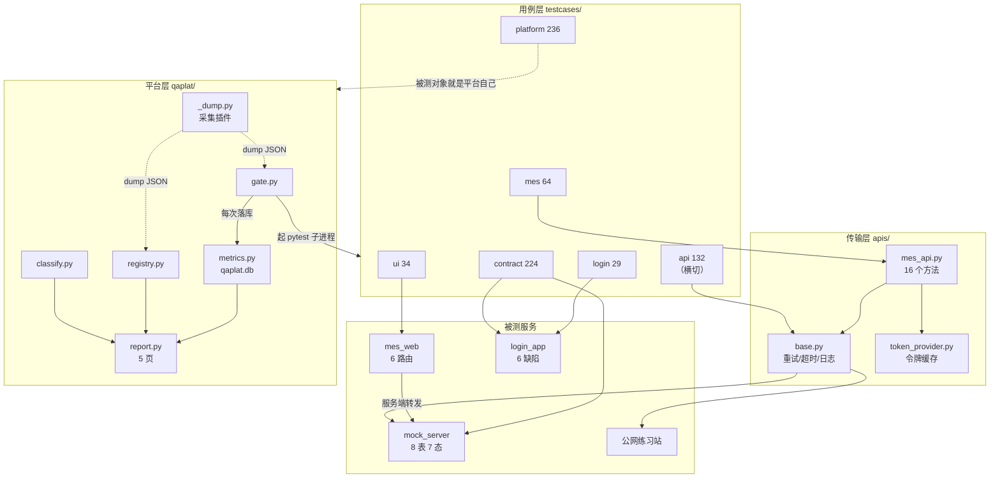
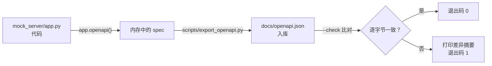

# 初学者完全入门：这个仓库是怎么转起来的

> **写给谁**：会用一点 Python、但没系统做过自动化测试的人。
> **读完你会知道**：一次 `pytest` 从启动到出报告，仓库里每一个子系统分别在什么时刻被唤醒、收到什么、吐出什么、交给谁。不是「有哪些文件」，而是「数据怎么流动」。
>
> 这份文档不教你「怎么用这个仓库」（看 [README](../README.md)），也不排学习计划（看 [6 周学习路线](../从入门到面试的6周学习路线.md)）。它只回答一个问题：**这个项目的整套运行逻辑是怎么串起来的。**

---

## 目录

**第一部分：整体**
- [第 0 章 全局地图：一次 pytest 都发生了什么](#第-0-章-全局地图一次-pytest-都发生了什么)

**第二部分：七个层次逐条拆解**
- [第 1 章 被测服务层：仓库里到底有几个活着的进程](#第-1-章-被测服务层仓库里到底有几个活着的进程)
- [第 2 章 传输层：一个请求从用例到数据库的完整路径](#第-2-章-传输层一个请求从用例到数据库的完整路径)
- [第 3 章 接口用例层：接口自动化怎么保证不假绿](#第-3-章-接口用例层接口自动化怎么保证不假绿)
- [第 4 章 业务全链路层：MES 那 64 条用例在做什么](#第-4-章-业务全链路层mes-那-64-条用例在做什么)
- [第 5 章 UI 层：浏览器、Page Object 与混合闭环](#第-5-章-ui-层浏览器page-object-与混合闭环)
- [第 6 章 契约层：把 OpenAPI 变成会红的门禁](#第-6-章-契约层把-openapi-变成会红的门禁)
- [第 7 章 平台层：qaplat 是怎么把跑的结果变成可查的历史](#第-7-章-平台层qaplat-是怎么把跑的结果变成可查的历史)

**第三部分：仓库之外**
- [第 8 章 性能、压测与流量回放](#第-8-章-性能压测与流量回放)
- [第 9 章 CI：九个 job 各自在把什么关](#第-9-章-ci九个-job-各自在把什么关)
- [第 10 章 工具链自检：让文档和代码不敢互相撒谎](#第-10-章-工具链自检让文档和代码不敢互相撒谎)

**第四部分：动手与速查**
- [第 11 章 自己动手改一处，看它怎么传导](#第-11-章-自己动手改一处看它怎么传导)
- [附录 A 一次完整运行的时序表](#附录-a-一次完整运行的时序表)
- [附录 B 数据与产物在哪](#附录-b-数据与产物在哪)
- [附录 C 术语表](#附录-c-术语表)
- [附录 D 文件速查](#附录-d-文件速查)

---

## 第 0 章 全局地图：一次 pytest 都发生了什么

### 0.1 先看总数

在动手读代码前，先把规模记住。这些数字都是从 `pytest --collect-only` 实测来的：

```
636 条用例，分布在 33 个测试文件里
```

按 marker 分组（一条用例可以同时属于多个组，所以加起来超过 636）：

| marker | 条数 | 说明 |
|---|---|---|
| `parametrize` | 268 | 参数化展开出来的，不是手写的（pytest 内置，不在 `pytest.ini` 里声明） |
| `platform` | 236 | 平台层自测（qaplat 自己） |
| `contract` | 224 | 契约层 |
| `api` | 132 | 接口用例（横切：含 `testcases/api/` 49 条 + `login` 29 条 + `mes` 54 条） |
| `regression` | 93 | 横切标签，不单独跑 |
| `mes` | 64 | MES 业务全链路 |
| `smoke` | 36 | 冒烟，横切标签 |
| `ui` | 34 | 需要浏览器 |
| `flaky` | 33 | 允许重跑 |
| `login` | 29 | 登录契约与缺陷探针 |
| `covers` | 16 | 声明覆盖了哪个 operationId |
| `xfail` | 11 | 已知缺陷，钉住（pytest 内置） |
| `perf` | 2 | 性能基线 |
| `quarantine` | 0 | 隔离区，当前是空的 |

**`pytest.ini` 声明了 12 个自定义 marker**（不含 `parametrize`/`xfail` 这类内置的），其中 `smoke`/`regression`/`flaky`/`quarantine` 是横切标签、CI 里没有各自的 `-m` step。

**为什么 636 而不是 397**：`grep "def test_"` 数出来是 397 个函数，但参数化会展开。比如 `test_add_multiple_items_to_cart` 一个函数带 `[1, 2, 3]` 三个参数，就变成 3 条用例。`test_schemathesis_properties.py` 单文件就展开出 188 条——那是 hypothesis 按 OpenAPI 生成的。

### 0.2 一次 `pytest` 的完整生命周期

```
你敲下 pytest
     │
     ├─① pytest 读 pytest.ini
     │     addopts = -v -raR --strict-markers
     │     testpaths = testcases
     │     markers = 12 个自定义标记
     │     ↑ 少写一个 marker 就会 --strict-markers 报错
     │
     ├─② 加载根 conftest.py（目录层级自动生效）
     │     ├─ sys.path 手动插入 4 个路径（ROOT / testcases / login / mes）
     │     ├─ import apis、common.config
     │     └─ 注册 3 个 fixture + 7 个 pytest 钩子（见下）
     │
     ├─③ 逐目录加载下层 conftest.py
     │     testcases/api/  testcases/contract/
     │     testcases/login/  testcases/mes/  testcases/ui/
     │
     ├─④ 收集（collect）：扫 test_*.py，把 def test_* 变成 item
     │     此时 marker 已知、fixture 已知、参数化已展开
     │
     ├─⑤ pytest_collection_modifyitems 钩子介入
     │     └─ 把 quarantine 用例踢出本次运行（并计入 deselected）
     │
     ├─⑥ 逐条执行（一条用例 = setup → call → teardown）
     │     ├─ setup：按依赖链构造 fixture（session 级只建一次）
     │     ├─ call：跑测试函数体
     │     └─ teardown：反向析构 fixture（清理数据在这里）
     │
     ├─⑦ 三条钩子在每条用例的 call 阶段之后依次跑
     │     ├─ ui/conftest 的 makereport → 失败截图
     │     ├─ 根 conftest 的 logreport → 记录 rerun
     │     └─ （allure / junitxml 各自的钩子）
     │
     ├─⑧ pytest_sessionfinish 钩子
     │     └─ 写 reports/flaky-governance.json（治理账本）
     │
     └─⑨ pytest_terminal_summary 钩子
           └─ 打印被隔离的用例清单
```

**关键认知**：pytest 不是一个「跑测试的程序」，它是一个**插件框架**，`conftest.py` 是插件，每个 `pytest_*` 函数都是挂载点。这个仓库大量利用这一点——数据清理、失败截图、flaky 留痕、环境信息写入，全是钩子干的，不在用例正文里。

### 0.3 六块区域各自的位置

读源码时最容易迷路的是「这个文件属于哪一层」。用下面这张表定位：

```
① 被测服务（被测试的东西，不是测试代码）
     mock_server/    MES 后端 Mock：FastAPI + SQLite，8 张表，7 态状态机
     login_app/      登录服务：故意留了 6 个已知缺陷
     mes_web/        Demo 网页：把 mock_server 的数据渲染成 HTML
     （公网）        jsonplaceholder.typicode.com / saucedemo.com

② 传输层（所有 HTTP 都从这里走）
     apis/base.py           统一重试/超时/日志
     apis/mes_api.py        MES 的封装方法（RoleClient 9 + MesApi 16）
     apis/token_provider.py 令牌缓存与提前刷新
     apis/user_api.py       公网接口封装

③ 用例层（写断言的地方）
     testcases/api/       公网接口
     testcases/mes/       本地 MES 全链路
     testcases/ui/        浏览器
     testcases/contract/  契约
     testcases/login/     登录契约与缺陷
     testcases/platform/  平台层自测

④ 支撑模块（被用例 import，不是用例）
     ui/pages/        Page Object
     common/          配置、口令、断言、YAML
     testcases/*/     各自的 ctl / factory / isolation 模块

⑤ 平台层（把「跑完了」变成「可查的历史」）
     qaplat/_dump.py    唯一采集入口（pytest 插件）
     qaplat/registry.py 覆盖矩阵
     qaplat/metrics.py  度量库 qaplat.db（3 张表）
     qaplat/gate.py     四层门禁
     qaplat/report.py   5 页自包含 HTML
     qaplat/classify.py 失败归因
     qaplat/paths.py    路径常量（其余模块的公共依赖）

⑥ 仓库之外（不参与 pytest 收集，或自带独立的运行方式）
     perf/run_load.py      locust 编排包装（阶梯加压）
     traffic-replay/       独立子项目，173 条用例，自带 pytest.ini
     scripts/ tools/       自检脚本与启动器
     .github/workflows/    CI 九个 job
```

**一条铁律**：箭头只能从 ③ 指向 ②，从 ② 指向 ①。`apis/` 绝不 import `testcases/`，`mock_server/` 绝不 import 任何测试代码。这样每一层都能单独测。

### 0.4 数据流全景



---

## 第 1 章 被测服务层：仓库里到底有几个活着的进程

初学者第一个困惑是「我没起服务，测试怎么能跑通」。答案：**测试自己起服务**。

### 1.1 四个被测对象

| 被测对象 | 技术栈 | 谁用它 | 为什么存在 |
|---|---|---|---|
| `mock_server/` | FastAPI + SQLite | `testcases/mes`、`contract`、`ui`（间接）、`api/test_perf_baseline` | 真实 MES 系统不能随便造数据，自己写一个 |
| `login_app/` | FastAPI + 无 DB | `testcases/login`、`contract/test_handwritten_parity` | 演示「怎么把缺陷钉成用例」 |
| `mes_web/` | FastAPI + f-string HTML | `testcases/ui/test_mes_mixed_flow`、`test_mes_web_app` | 演示「接口造数 → 网页操作 → 接口验证」 |
| 公网两个站 | 外部 | `testcases/api`、`testcases/ui/test_login.py` 等 | 练习用的现成网站 |

**为什么把被测服务放进仓库**：这是刻意的设计。真实业务系统的状态不可控，你无法让它在「库存刚好剩 5 个」的精确时刻返回 400。自己写一个能做到——而且能把「超卖」「重复提交」「状态机非法跃迁」这些只在生产事故里出现的情况变成每次都复现的用例。

### 1.2 一次 `-m mes` 会起几个进程

这是最容易搞错的地方。跑 `pytest -m mes` 时，仓库会拉起**一个**服务进程：

```
第 1 个（session 级，整个会话共用一个）：
    mock_server
    端口：系统随机分配（不是写死的 8000）
    数据库：tmp_path_factory 建的临时目录里的 mes_session.db
    日志：同一个临时目录里的 server.log
```

但跑 `pytest -m ui` 时，会拉起**四个**：

| fixture | 谁定义的 | 类型 | 数据库 |
|---|---|---|---|
| `mixed_mock_server` | `testcases/ui/test_mes_mixed_flow.py:36-37` | mock_server | `mes_mixed.db` |
| `mixed_mes_web` | `testcases/ui/test_mes_mixed_flow.py:45-46` | mes_web | 无（转发） |
| `http_mock_server` | `testcases/ui/test_mes_web_app.py:34-35` | mock_server | 另一个临时库 |
| `http_mes_web` | `testcases/ui/test_mes_web_app.py:45-46` | mes_web | 无（转发） |

**为什么不能复用一套**：pytest 的 `conftest.py` **只对自身目录及以下生效**。`testcases/ui/` 看不到 `testcases/mes/conftest.py` 里定义的 `mes_server`。这是 pytest 的作用域规则，不是设计失误。

有两条路可以绕过（改 conftest 提到根目录，或把 fixture 提取成公共模块），但仓库契约 `FROZEN_MESWEB.md` 明确禁止改 conftest，所以选了「各建各的」。代价是多起几个进程，好处是 `testcases/ui/` 可以独立运行，不依赖 `testcases/mes/`。

### 1.3 `MockServer` 类的三层启动逻辑

`testcases/mes/mock_server_ctl.py`（225 行）不是简单地 `subprocess.Popen`。它的三层结构值得学：

```python
# 第一层：找解释器
python = launcher_python(DEFAULT_PYTHON, "MOCK_PYTHON")  # common/launch.py
#   Windows → .venv/Scripts/python.exe
#   其他   → 当前解释器 sys.executable
#   为什么不能一律用 venv：WSL 里 .venv/Scripts/python.exe 存在但 exec 会失败
#   （报 UtilBindVsAnyPort 或 Exec format error）

# 第二层：起进程
proc = subprocess.Popen([python, "scripts/service_launcher.py", "mock_server.run", ...])
#   为什么需要 scripts/service_launcher.py 中转：uvicorn 收到关闭信号后会"重发信号"
#   并走默认处置——默认处置不跑 atexit，而覆盖率数据挂在 atexit 上落盘，
#   于是 mock_server/* 覆盖率恒 0%。这个脚本先装一个"吸收重发信号"的 handler。

# 第三层：健康检查
self._wait_healthy(timeout=30)
#   不是只看端口通不通，而是核对 /healthz 返回的 database 路径
#   是不是我们期望的那个临时库
```

**第二层的真实原因值得单独说**（`scripts/service_launcher.py:3-12`）：

```
* uvicorn 收到 SIGINT/SIGTERM/SIGBREAK 后，`capture_signals()` 的 finally 会把
  原来的 handler 装回去，然后 `signal.raise_signal(原信号)` **把信号重发给自己**，
  让"默认处置"结束进程。默认处置不跑 `atexit`。
* 覆盖率数据（无论 pytest-cov 的 `COV_CORE_*` 通道还是 coverage 自己的
  `COVERAGE_PROCESS_START` 通道）都挂在 `atexit` 上落盘。于是服务跑了一整轮，
  分片文件却只有启动时写下的空壳 —— 这就是 `mock_server/*` 覆盖率恒 0% 的原因。
```

**这是本仓库最有辨识度的一处「测试基础设施为可观测性让步」**：为了让覆盖率能落盘，专门写了一个对被测试服务完全透明的启动器（`runpy.run_module`），而不是去改被测服务的代码——「覆盖率不该要求被测对象改代码」。

**第三层为什么这么严**：因为「服务其实没起起来、请求打到了别的端口」是这类测试最隐蔽的失败。如果本机端口上恰好有个手工跑着的 mock_server，健康检查会通过，但所有断言都在打一个陈旧的数据库。核对数据库路径能挡住这个（`_wait_healthy` 的注释原话是「曾经出现过：服务起来了、探针也 200，但读请求落在默认库上，写库却写对了」）。

### 1.4 停止服务为什么是「先礼后兵三段式」

```python
self._signal_graceful()  # 第一段：CTRL_BREAK_EVENT（Windows）/ SIGTERM（POSIX）
try:
    proc.wait(timeout=10)  # 第二段：等它自己走（atexit 才有机会跑）
except TimeoutExpired:
    proc.terminate()  # 第三段：优雅失败，退回强迫退出
    try:
        proc.wait(timeout=10)
    except TimeoutExpired:
        proc.kill()
        proc.wait(timeout=10)
```

**为什么第一段不能直接用 `terminate()`**（`testcases/mes/mock_server_ctl.py:185-192`）：

```
为什么不能只留一句 terminate()：Windows 上它是 TerminateProcess，进程没有机会
跑 atexit，而覆盖率数据（pytest-cov 的 COV_CORE_* 通道）恰恰挂在 atexit 上落盘。
结果就是服务实打实跑了一整轮，分片文件里却一行数据都没有 —— 这就是覆盖率盲区。

优雅信号在 Windows 上是 CTRL_BREAK_EVENT（子进程以 CREATE_NEW_PROCESS_GROUP 启动
才收得到），在 POSIX 上是 SIGTERM；两条路 uvicorn 都会正常关闭，再由
scripts/service_launcher.py 吸收它重发的信号，进程从 main() 返回、atexit 执行。
优雅退出失败时退回原地 terminate 再 kill，保证不会留下卡住 CI 的僵尸进程。
```

**一段式（直接 kill）的问题**：`atexit` 不执行 → 覆盖率分片为空 → 「服务跑了一整轮，却一行数据都没有」。

**两段式（terminate + wait）的问题**：卡死时 `wait()` 会一直阻塞，CI 上表现为「job 超时」而不是「用例失败」，排查方向从头就错了。

### 1.5 `mock_server` 内部：8 张表与 7 态状态机

`mock_server/db.py` 建了 8 张表：

```
users              种子账号（6 个角色）
materials          物料主数据
work_orders        工单（核心表）
production_batches 生产批次
stock              库存（available_milli / issued_milli）
stock_ledger       库存流水（只增不改）
inspections        质检记录
idempotency_keys   幂等键（唯一索引）
```

注意 `available_milli` 这个命名——金额和数量都用**整数千分之一**存，不用浮点。这是财务/库存系统的标准做法：`0.1 + 0.2 != 0.3` 在账务上是灾难。

7 态状态机写在 `mock_server/services.py`：

```python
ALLOWED_TRANSITIONS = {
    "PENDING": ("APPROVED", "CANCELLED"),
    "APPROVED": ("SCHEDULED", "CANCELLED"),
    "SCHEDULED": ("IN_PROGRESS", "CANCELLED"),
    "IN_PROGRESS": ("COMPLETED", "CANCELLED"),
    "COMPLETED": ("SHIPPED",),
    "SHIPPED": (),  # 终态，无出口
    "CANCELLED": (),  # 终态，无出口
}
```

**为什么用一张表而不是一堆 if**：注释里写了两个好处——新增状态只改这张表；用例可以**参数化遍历这张表**做「非法跃迁全覆盖」，而不是人工挑两三种组合。

### 1.6 一个请求在 `mock_server` 里的完整处理链

以「生产领料」`POST /inventory/issue` 为例（`mock_server/routers.py:553`）：

```python
def issue_material(request, payload: IssueIn, current: CurrentUser = Depends(require_permission("inventory:issue"))):
    order_no = request.headers.get("X-Work-Order-No")
    guard = IdempotencyGuard(request, "inventory:issue", payload.model_dump())
    with guard:  # ← 先占坑
        replay = replay_or_none(guard)  # ← 撞坑就回放上次响应
        if replay is not None:
            return replay
        with write_tx() as conn:  # ← BEGIN IMMEDIATE 拿写锁
            result = services.issue_material(conn, payload, current, order_no=order_no)
        guard.store_response(200, result)
    return result
```

这条链上有五个机制，每个都对应一类真实事故：

| 机制 | 代码位置 | 防的事故 |
|---|---|---|
| 权限检查 `Depends` | `routers.py:556` | 越权操作 |
| 幂等键「先占坑再干活」 | `idempotency.py:11-19`（模块注释解释了顺序为什么不能反） | 网络超时重试导致重复领料 |
| 请求体校验 | FastAPI 自动 | 传了未定义字段却以为生效 |
| `BEGIN IMMEDIATE` | `db.py:write_tx` | 并发超卖 |
| 业务异常 → 4xx | `services.py` 抛 `InsufficientStock` | 库存不足却不报错 |

**关键顺序**：权限检查（`Depends`）在请求体校验**之前**执行。所以「无权限 + 缺字段」返回 403 而不是 422。这个顺序我实测过，也写在后文实验 3 里。

### 1.7 幂等为什么必须「先占坑」

`mock_server/idempotency.py` 的模块注释把这件事讲透了：

```
要防的线上事故：网络超时导致的重复提交。
客户端 POST 创建工单，服务端已经落库，但响应在网络上丢了。客户端重试，
于是同一个业务动作产生了两条工单——车间照着两个工单各领一次料，
多出来的库存和产能消耗要月底对账才发现。

注意"先占坑再干活"的顺序：如果反过来（先干活再写幂等键），
两个并发请求会同时通过检查、各干一次，幂等就白做了。
```

三种结局：

- 已 `DONE` 且指纹一致 → 回放上次响应（客户端看到 201，语义一致）
- 已 `DONE` 但指纹不同 → `409 IDEMPOTENCY_KEY_CONFLICT`（复用键传了别的数据，这是客户端 bug）
- 还 `IN_PROGRESS` → `409 IDEMPOTENCY_IN_PROGRESS`（并发的同一请求，直接拒绝比等待更安全）

### 1.8 `WAL + BEGIN IMMEDIATE` 是「不超卖」的关键

`mock_server/db.py` 的 `write_tx()` 注释：

```
写事务：BEGIN IMMEDIATE，开头就拿写锁。

这是"不超卖"的关键。如果用 DEFERRED，两个并发请求会同时读到
库存 120，各自判断"够扣"，然后一个 COMMIT 成功、另一个在 COMMIT 时才
报锁冲突——此时业务判断已经做完了，只能整个回滚重来。
IMMEDIATE 让第二个请求在 BEGIN 就排队，读到的一定是最新余额。
```

配套的还有一个 `concurrency_window()` 函数（`services.py`），专门在「查库存」和「扣库存」之间插一段 sleep，把竞态窗口放大到必然发生。**这是故意的**——没有它，竞态是概率性的，用例会时不时绿一次，让人以为代码没问题。

---

## 第 2 章 传输层：一个请求从用例到数据库的完整路径

### 2.1 为什么用例里看不到 `requests`

```python
# 用例里从来不这样写
resp = requests.post(f"{base_url}/api/v1/materials", json={...})

# 而是这样
resp = mes.as_role("ADMIN").post("/materials", json={...})
```

**理由**：如果 50 个文件各写一遍 URL，接口地址变了要改 50 处。所以有了 `apis/` 这一层。

### 2.2 三层结构

```
apis/user_api.py        最上层：业务语义（login / create_user / list_users）
apis/mes_api.py         最上层：业务语义（RoleClient 9 个 + MesApi 16 个方法，见 2.5）
      ↓
apis/base.py            中间层：统一重试、统一超时、统一日志
      ↓
requests.Session        底层：连接池
```

`BaseApi` 的核心是 `request()` 方法，它做四件事：

```python
def request(self, method, path, **kwargs):
    method = method.upper()
    url = f"{self.base_url}{path}"
    attempts = 1 + (self.retries if method in IDEMPOTENT_METHODS else 0)
    for attempt in range(attempts):
        try:
            resp = self.session.request(method, url, timeout=self.timeout, **kwargs)
        except (ConnectionError, Timeout) as exc:
            if attempt + 1 >= attempts:
                raise
            time.sleep(...)  # 退避
            continue
        if resp.status_code in RETRY_STATUS and attempt + 1 < attempts:
            time.sleep(...)
            continue
        return resp
```

### 2.3 四个容易被忽略的重试细节

**细节 1：只对幂等请求重试**

```python
IDEMPOTENT_METHODS = frozenset({"GET", "HEAD", "OPTIONS", "PUT", "DELETE"})
```

`POST` 不在此列。为什么：POST 可能是「创建工单」，重试就是造了两条工单。所以 POST 想重试必须由调用方显式提供幂等键（`mes_api.py:91` 的 `post_idem`）。

**细节 2：可重试的状态码是白名单**

```python
RETRY_STATUS = frozenset({429, 500, 502, 503, 504})
```

只有这五个。400 / 401 / 403 / 404 / 422 都是确定性错误，重试一万次也是一样的结果，重试只会让失败慢 3 倍。

**细节 3：超时只有一个真实来源**

超时不写在 `data/config.yaml` 里，而是环境变量：

```powershell
$env:API_TIMEOUT = "15"    # 单次请求超时秒数
$env:API_RETRIES = "2"     # 幂等请求的重试次数
```

`data/config.yaml` 的注释解释了原因：

```
# 传输层超时不在这里配：它归 BaseApi 管，用环境变量调
# 这样"超时和重试"只有一个真实来源，不会 YAML 改了一套、代码里跑着另一套。
```

**细节 4：重试有第二层，但要收窄**

`apis/base.py` 的重试是传输层的。`testcases/api/` 那 4 个打公网的用例文件还有一层，由 `testcases/api/flaky_policy.py`（`NETWORK_JITTER_PATTERNS` 在 `:22-37`）控制：

```python
NETWORK_JITTER_PATTERNS = [
    r"实际状态码: (?:429|5\d\d)",  # 限流 / 网关抖动
    r"Max retries exceeded",
    r"ConnectionError",
    r"Timeout",
    r"响应不是合法 JSON",  # Cloudflare 错误页
    r"接口响应过慢",
]
NETWORK_FLAKY = pytest.mark.flaky(reruns=1, only_rerun=NETWORK_JITTER_PATTERNS)
```

**为什么不用全局 `--reruns`**：`pytest.ini:10` 明确写了——

```
# 注意这里**故意不写 --reruns**：全局重跑会连真回归一起吞掉（见 flaky marker 的说明）。
```

`only_rerun` 的机制是：失败信息**不匹配**上面任何一条正则时，插件立刻硬失败，一次都不重跑。所以「字段不匹配」「Schema 校验失败」这类真回归不会被重跑掩盖。

### 2.4 `TokenProvider`：令牌为什么要单独一个文件

`apis/token_provider.py`（174 行）解决两个问题：

**问题 1：每个请求都登录一次太慢**

```python
class TokenProvider:
    def get(self) -> str:
        if self._token and not self._expiring_soon():
            return self._token  # 缓存命中
        with self._lock:  # 双检锁
            if self._token and not self._expiring_soon():
                return self._token  # 拿到锁后再查一次
            self._login()  # 真的去登录
            return self._token
```

双检锁防止并发时多个线程同时去登录。

**问题 2：令牌在用例跑到一半时过期**

```python
TOKEN_REFRESH_MARGIN_SECONDS = 60  # 默认提前 60 秒
```

离到期还有 60 秒就提前换新的。把它设成 `0` 就是「等真的过期再换」——想手工复现「令牌过期」的 bug 时就这么干。

**为什么这块值得单独一个文件**：`testcases/mes/test_token_lifecycle.py`（15 条用例）专门测它。令牌刷新是「测试基础设施」的典型代表——它本身有 bug 时，表现是所有用例莫名其妙 401，排查方向会指向被测服务而不是测试代码。

### 2.5 `MesApi` 的公开接口

`apis/mes_api.py`（272 行）不是简单的方法集合。它由两个类组成：`RoleClient`（9 个方法）和 `MesApi`（16 个方法，其中 5 个是 `expect_*` 断言辅助）。三个值得学的设计：

**设计 1：`as_role()` 返回一个带令牌的子客户端**

```python
mes.as_role("ADMIN").post("/materials", json={...})
```

`RoleClient` 持有 `(mes_api, token_provider, username, role)`，`token` 是**只读属性**、每次都向 provider 要当前值。注释说明了为什么不能缓存成字符串：

```
改造前这里存的是 `self.token`（登录那一刻的字符串），后果是：
令牌在别处刷新之后，这个视图仍然拿着旧值继续发请求 —— 也就是
"同一个对象里两个令牌来源"这种串号/过期事故的典型形态。
```

**设计 2：`expect_*` 系列把断言包装成有上下文的失败**

```python
@classmethod
def expect_ok(cls, resp, status: int = 200):
    # 失败时输出：期望 200，实际 400；响应体：{"code":"INSUFFICIENT_STOCK",...}
```

对比一下裸 `assert resp.status_code == 200` 的输出：

```
AssertionError                          ← 就这样，什么都没有
```

**设计 3：`post_idem()` 显式带幂等键**

```python
def post_idem(self, path, key, json=None, **kwargs):
    # docstring：「幂等是这批用例的重点，单独给个入口提醒别忘传」
    headers = dict(kwargs.pop("headers", None) or {})
    headers[IDEMPOTENCY_HEADER] = key
    return self.post(path, json=json, headers=headers, **kwargs)
```

**注意 `MesApi` 的默认 `retries=0`**（`mes_api.py:102`）：

```
默认不重试：Mock 服务返回的 4xx/409 是**业务结论**，不是网络抖动。
BaseApi 默认 retries=2 对 GET 的 5xx 会重试，这在被测系统上没问题，
但我们的用例要精确数请求次数（幂等/并发），重试会让计数失真。
```

**这是「同一个传输层、两套重试策略」的分层价值**——`BaseApi` 的默认值面向公网，`MesApi` 覆盖成 0 面向精确计数。

---

## 第 3 章 接口用例层：接口自动化怎么保证不假绿

`testcases/api/` 有 7 个测试文件、**49 条用例**（含参数化）。它们分两类，**打的是完全不同的目标**：

| 文件 | 条数 | 打谁 | 用途 |
|---|---|---|---|
| `test_user_list.py` | 11 | 公网 jsonplaceholder | 基础接口断言，练习用 |
| `test_user_create.py` | 12 | 同上 | 同上 |
| `test_post.py` | 8 | 同上 | 同上 |
| `test_retry_after.py` | 9 | 本地桩服务 | 测 `Retry-After` 头的解析与退避 |
| `test_perf_baseline.py` | 2 | **本地 mock_server** | 性能基线门禁 |
| `test_response_time.py` | 2 | 公网 | 连通性冒烟（**不是**性能门禁） |
| `test_flaky_governance_meta.py` | 5 | 不自证 | 验证 flaky 治理机制本身是活的 |
| — | 49 | | 目录合计 |

### 3.0 一个容易搞混的地方：`-m api` 是 132 条，不是 49 条

`api` 是**横切 marker**，不是目录标签。实测 `pytest -m api --collect-only` → 132 条，分布如下：

```
testcases/api/            49   （整个目录都打了 api）
testcases/login/          29   （test_login_contract.py）
testcases/mes/            54   （test_mes_smoke 7 + test_mes_business 23
                                + test_token_lifecycle 15 + test_auth_secrets 9）
────────────────────────────
合计                     132
```

**为什么 MES 的用例也打 `api`**：因为它们同样是「纯 HTTP、不需要浏览器」的接口用例，只是被测对象是本地 Mock 而不是公网。`pr` 层的表达式 `smoke or api or platform` 正是靠这个横切关系把三层一次性收进来。

**这是本项目 marker 体系里最反直觉的一点**：目录 != marker。`testcases/mes/` 的用例同时属于 `api` 和 `mes` 两个组。

### 3.1 为什么 `test_response_time.py` 不是性能门禁

这两个文件的注释里反复强调，因为混淆会导致改坏门禁时无从判断谁该红：

```
test_perf_baseline.py:
- 本文件测的是**本地 mock_server**，可复现，是真正的性能基线；
- `test_response_time.py` 那两条打的是公网 jsonplaceholder，结果是"本机到海外的链路质量"，
  属于抖动类，**与基线无关**，只保留为连通性冒烟。
```

### 3.2 性能基线是怎么工作的

**基线文件**：`testcases/api/perf_baseline.json`（入库的，不是产物）

```json
{
  "schema_version": 1,
  "generated_at": "2026-10-14T15:47:31+00:00",
  "generated_by": "UPDATE_PERF_BASELINE=1 pytest -m perf",
  "environment": {
    "sut": "mock_server（本地 FastAPI + SQLite，非公网）",
    "sut_host": "http://127.0.0.1:12990",
    "platform": "Windows-11-10.0.26200-SP0",
    "python": "3.12.10",
    "processor": "Intel64 Family 6 Model 154 Stepping 3, GenuineIntel",
    "cpu_count": 16,
    "samples_per_endpoint": 100,
    "warmup_discarded": 10,
    "percentile_method": "nearest-rank",
    "threshold_rule": "baseline_p95 × 3.0 + 10.0ms"
  },
  "endpoints": {
    "GET /healthz": {
      "p50_ms": 2.32, "p95_ms": 2.79, "p99_ms": 2.93,
      "max_ms": 2.95, "mean_ms": 2.25, "samples": 100
    },
    ...
  }
}
```

**6 个被采样的端点**：`GET /healthz`、`GET /materials?page_size=20`、`GET /materials/MAT-CU-001`、`GET /inventory/stock`、`GET /work-orders?page_size=20`、`GET /inventory/ledger`。全是只读 GET，不写数据，所以可以反复采。

**阈值规则**：`基线 P95 × 3.0 + 10ms`。为什么要 ×3 加 10：P95 本身有抖动，直接比 1.0 倍会天天红。3 倍是「明显劣化才拦」的宽松线。

**判定逻辑**（`testcases/api/perf_baseline.py`）：

```python
# 分位数用 nearest-rank，不插值
# 样本 100 个，P95 取第 95 个（排序后），不是第 94.05 个
# 为什么：插值会造出一个库里不存在的数字，而性能基线要能被人工复核
```

**两条硬约束**（`test_perf_baseline.py:108-111`）：

```
1. 只能由一次**真实采集**写文件——数字全部来自 stats，代码里没有任何可手编的路径；
2. 必须打印旧值→新值。否则"重新采集"与"悄悄放宽门禁"的输出将无法区分，
   而门禁的放松必须留痕。
```

**重采命令**：

```powershell
$env:UPDATE_PERF_BASELINE = "1"
pytest -m perf
```

### 3.3 `trust_env = False`：一个真实的坑

`testcases/api/conftest.py` 的 `perf_session`（`:70-89`）有一段实测记录：

```
**必须显式 `trust_env = False`。** 默认的 `requests.Session` 会读
`HTTP_PROXY` / `HTTPS_PROXY`，把发往 `127.0.0.1` 的采样请求交给代理。
实测（2026-10-19，本机导出 `HTTP_PROXY=http://127.0.0.1:7897`）：

    未禁用：P50 15.4ms / P95 30.1ms → 6 个端点全部超出预算，用例红
    trust_env=False：P50 2.8ms  → 2 passed in 4.20s

也就是说这份「性能基线」在没有这行时量的是**代理的转发延迟**。
```

**这个坑的教训**：采样测的东西必须只由被测服务决定。环境里有代理是开发机的常态，让「本机服务」绕代理一圈既不必要也不正确。更糟的是它不会每次都红——代理空闲时 30ms 可能刚好在预算内，于是变成一个偶发红，而偶发红通常被当成「机器慢」，根因就此长期潜伏。

### 3.4 `test_flaky_governance_meta.py`：让治理机制自证

这 5 条用例不是为了测业务，而是为了证明「flaky 治理机制本身是活的」。核心思路：**注入一个会失败的用例，看账本是否记下它**。如果账本永远写空，说明机制坏了，而不是「没有 flaky」。

---

## 第 4 章 业务全链路层：MES 那 64 条用例在做什么

`testcases/mes/` 是整个仓库最厚的一层，**14 个 .py 文件**（8 个支撑模块 + 6 个测试文件）。

### 4.1 目录里每个文件是什么

| 文件 | 行数 | 角色 |
|---|---|---|
| `conftest.py` | 216 | fixture：起服务、给客户端、给工厂、会话级基线检查 |
| `mock_server_ctl.py` | 225 | 启动/停止被测服务 |
| `data_factory.py` | 441 | 造数据 + 登记回收 |
| `data_isolation.py` | 161 | 隔离性快照与比对 |
| `data_ttl.py` | 505 | 历史数据过期清理（独立工具） |
| `concurrency.py` | 77 | 并发用例的**判定口径** |
| `_fault_probe.py` | 61 | 故障注入探针（故意失败） |
| `_leak_probe.py` | 26 | 泄漏注入探针（故意失败） |
| `test_mes_smoke.py` | 185 | 7 条冒烟 |
| `test_mes_business.py` | 695 | 23 条业务（含权限矩阵 7 条、超卖） |
| `test_token_lifecycle.py` | 386 | 15 条令牌生命周期 |
| `test_data_lifecycle.py` | 322 | 9 条数据隔离验证 |
| `test_auth_secrets.py` | 157 | 9 条口令来源验证 |
| `test_coverage_collection.py` | 85 | 1 条，验证服务子进程的覆盖率分片里有真实行 |

实测收集数核对（`pytest testcases/mes --collect-only -q` → `64 tests collected`，解析收集树按文件统计）：

```
test_auth_secrets.py        9
test_coverage_collection.py 1
test_data_lifecycle.py      9
test_mes_business.py       23   ← 其中 7 条是 test_permission_matrix[...] 参数化展开
test_mes_smoke.py           7
test_token_lifecycle.py    15
─────────────────────────────
合计                       64
```

> 提示：`test_mes_business.py` 的 23 条里有 7 条是 `test_permission_matrix[新建物料]` 这样的参数化展开，所以条数比函数数多。本目录 `grep "def test_"` 数出来是 58 个函数 —— 58 展开成 64。

### 4.2 三层数据防线

这是这一层最核心的设计。

**第一层：`factory` fixture 的 teardown，逐条用例清理**

```python
@pytest.fixture
def factory(mes, mes_server):
    f = DataFactory(mes, mes_server.root_url, mes_server.db_path)
    yield f
    # 以下在用例结束后执行，即使断言失败也执行（这是 yield 型 fixture 的意义）
    chain_errors = ledger_balance_chain_errors(mes_server.db_path)  # ① 先验流水链
    cleanup_error = None
    try:
        actions = f.cleanup()  # ② 再回收
    except BaseException as exc:
        actions, cleanup_error = [], exc
    residues = f.verify_clean()  # ③ 再复核
    ...
```

**为什么先验流水链、再 cleanup**（`testcases/mes/conftest.py:74-77`）：

```
为什么在回收**之前**先验一次流水余额链：
`cleanup()` 会把用例自己造的流水行删掉，等会话收尾取快照时流水表已经空了，
"只 UPDATE 流水金额"这类错账再也无从比对。流水只增不改、行还在的时候是唯一能验它的时点。
```

**为什么两件事互不阻断**（`testcases/mes/conftest.py:79-85`）：

```
早先这里是"先断言流水链、再 cleanup()"的直线代码 —— 断言一旦失败，
`cleanup()` 那行就永远走不到，用例造的数据全留在库里。真正的原因（账实不符）
反而被"会话收尾行数对不上"这层噪声盖住，排查方向被指到别处。
所以现在两件事互不阻断：回收**一定**执行。
```

**第二层：`data_isolation_check`，session 级收尾检查**

```python
@pytest.fixture(scope="session", autouse=True)
def data_isolation_check(mes_server):
    before = snapshot(mes_server.db_path)
    yield
    after = snapshot(mes_server.db_path)
    assert before == after, "会话结束时数据没有回到基线 —— ..."
```

**为什么除了行数还要看库存合计**（`testcases/mes/conftest.py:148-149`）：

```
领料/退料只 UPDATE 一行，行数不变但账实已经不符，行数指标抓不到这种泄漏。
```

**为什么挂在 session 级而不是每条用例**（`testcases/mes/conftest.py:151-153`）：

```
工厂方法造完数据、下一条用例还没跑时，行数本来就是"临时脏"的；
逐条查会把正常流程判成污染。会话级才是"该还的东西都还了没有"的正确时点。
```

**第三层：`baseline_counts`，用实测代替硬编码**

```python
measured = row_counts(mes_server.db_path)
for table, expected in SEED_BASELINE.items():
    assert measured[table] == expected, "种子数据基线与预期不符"
```

注释说明：用实测而不是硬编码，是因为种子数据以后可能加料；硬编码的基线会在别人改种子时变成假失败。

### 4.3 流水余额链怎么验

这是最精巧的一处。库存流水表 `stock_ledger` 是「只增不改」的，每一行记一个 `balance_after`（操作后余额）。验证方法：

```python
# 按时间顺序遍历某个物料的所有流水
# 初始余额 = 0
# 每条流水：balance_after == 上一条的 balance_after + 本条变动量
# 最后一条的 balance_after == stock 表当前的 available_milli
```

**如果有人在事务外直接 `UPDATE stock_ledger` 改了金额**，这条链就断了，用例会红，并打印：

```
流水账面余额与实际库存对不上（账实不符）—— 明细在下面：
...
排查方向：写流水时余额没有按'当时的真实账面'计算，
或者有人在事务外直接 UPDATE 了 stock_ledger 的金额列。
```

### 4.4 并发用例怎么证明确实并发过

`conftest.py` 的 `race` fixture 用 `threading.Barrier` 让所有线程在起跑线对齐：

```python
barrier = threading.Barrier(workers, timeout=30)


def wrapper(index, fn):
    barrier.wait()  # ← 所有线程在这里等齐
    started = time.perf_counter()
    results[index] = fn()
    spans[index] = (started, time.perf_counter())
```

**为什么不能「起 N 个线程然后 join」**（`testcases/mes/conftest.py:172-174`）：

```
线程创建本身有先后，第一个请求可能已经跑完，第 N 个才刚发出，
这样根本构不成竞态——用例会"稳定通过"，但什么都没验证到。
```

**但光有 Barrier 还不够**，`concurrency.py` 的模块注释点出了更深的问题：

```
fixture 是可以被**整体替换**的。判定口径一旦写在 fixture 内部（或依赖 fixture
自己去做断言），有人把 race 换成"起 N 个线程依次 join"、甚至一个普通 for 循环时，
自检会跟着一起消失，用例照样全绿 —— 这正是并发用例最典型的一种假绿。

所以口径放在这里，断言写在用例正文里，替换任何 fixture 都抹不掉。
```

所以 `race` 返回第三个值——**每个请求的起止时间**——由用例断言这些区间真的交叠过。

### 4.5 两个「故意失败」的探针

`_fault_probe.py` 和 `_leak_probe.py` 的文件名以下划线开头，**不会被 pytest 收集**（`python_files = test_*.py`）。它们是**被别的用例调用的**：

- `_leak_probe.py`：绕过工厂造数据且不登记回收，用来验证会话级断言**真的会红**
- `_fault_probe.py`：让流水链断言失败，验证「回收不被断言挡掉」这个修复**真的生效**

**为什么必须这样写**（`_fault_probe.py` 注释）：

```
为什么不是"正文随便抛个异常"就算：
试过那种写法 —— 它在**修复前**也是绿的。原因很直白：用例正文抛异常根本不影响
fixture 的 teardown 往下走，`cleanup()` 照样执行。
```

**这是一个重要的方法论**：验证「防御机制有效」不能靠读代码，要靠构造一个必然触发它的场景，并确认它真的响了。

### 4.6 权限矩阵用例

`test_mes_business.py` 里有一个 7 项的 `PERMISSION_MATRIX`（新建物料 / 删除物料 / 审核工单 / 发货 / 质检录入 / 生产领料 / 退料），参数化展开成 7 条用例，每条遍历「角色 × 操作 × 期望状态码」。

**双向断言**：

```python
# 有权限的角色必须成功
assert resp.status_code == 201
# 无权限的角色必须被拒
assert resp.status_code == 403
```

只测一半是不够的——只测「ADMIN 能建」不能证明「OPERATOR 不能建」。

**一个真实的坑（我修过）**：「新建物料」这项最初只给了 `material_code` 和 `name` 两个字段，而接口有 5 个必填字段。有权限的 ADMIN 因此拿到 422 而不是 201，导致下方 `resp.status_code == 201` 的登记条件永不成立、`register_material()` 永不执行——**回收登记被静默跳过**。

这个案例说明：用例绿着，也可能有一条路径从来没被执行过。

### 4.7 `data_ttl.py`：一个「靠 OR 侥幸正确」的 bug

这是另一个我修过的真实缺陷。`baseline_row_counts` 的 stock 子句：

```python
# 修复前
predicates = [f"({col} = ? AND warehouse = ?)" for col in frozenset({...})]
params = sorted({...})
```

谓词按 `frozenset` 的**迭代序**生成，参数按 `sorted()` 展开。实测第 3、5 项互换。

**为什么没被发现**：因为整体是 OR 联合，每个谓词都是一对完整等值对，匹配集合恰好还对。但这种「靠 OR 侥幸正确」的写法，一旦把 OR 改成 AND 或给谓词加第三列就会静默算错。

**修复**：只展开一次 `sorted()`。

---

## 第 5 章 UI 层：浏览器、Page Object 与混合闭环

### 5.1 三个 Page Object

| 文件 | 目标站 | 类 | 选择器策略 |
|---|---|---|---|
| `ui/pages/login_page.py` | saucedemo | `LoginPage` | `#id` + `[data-test='error']` |
| `ui/pages/inventory_page.py` | saucedemo | `InventoryPage` | `.class` + `[data-test^='add-to-cart']` |
| `ui/pages/mes_web_pages.py` | 本地 mes_web | `MesLoginPage`、`WorkOrdersPage` | **全部** `[data-test="..."]` |

**为什么 mes_web 全用 `data-test`**：`FROZEN_MESWEB.md` §5 冻结了这些属性名，改它们等于改契约。

**核心机制：锚点正则找行**（`mes_web_pages.py:112-113`）：

```python
cell = self.page.locator(self.ORDER_NO, has_text=re.compile(rf"^{re.escape(order_no)}$"))
return self.page.locator(self.ROWS).filter(has=cell)
```

用**锚点**正则而不是子串。模块 docstring 解释了原因：

```
子串匹配在单号互为前缀时会静默串行（`WO-1` 会匹配到 `WO-10`），这种错最难查。
```

**等待策略**：三处显式等待代替 sleep（`inventory_page.py:24` 的注释：「显式等待：等业务元素出现，而不是 `page.wait_for_timeout(3000)`」）。

### 5.2 浏览器生命周期：为什么 scope 不一样

`testcases/ui/conftest.py` 开头就把这个决定写清楚了：

```
- browser 用 session：启动浏览器很贵（1-3 秒），整个会话只启动一次；
- context 必须用 function：浏览器上下文是 cookie / localStorage 的隔离边界。
  saucedemo 的购物车就存在 localStorage 里——如果 context 共用，
  上一条用例加的商品会串到下一条，表现为「加了 1 个，角标显示 2」这种假失败。
  创建 context 的成本远低于启动浏览器（几十毫秒），完全值得。
- page 用 function：每条用例一个干净标签页。
```

```python
@pytest.fixture(scope="session")
def browser():
    with sync_playwright() as p:
        browser = p.chromium.launch(headless=True)
        yield browser
        browser.close()


@pytest.fixture
def browser_context(browser):
    context = browser.new_context(viewport={"width": 1440, "height": 900})
    yield context
    context.close()


@pytest.fixture
def page(browser_context):
    page = browser_context.new_page()
    yield page
    page.close()
```

**注意**：仓库手写了 `sync_playwright`，没用 `pytest-playwright` 插件（虽然 `requirements.txt` 里装了）。所以这个插件的功能在本仓是闲置的。

### 5.3 失败自动截图

```python
@pytest.hookimpl(hookwrapper=True)
def pytest_runtest_makereport(item, call):
    outcome = yield
    report = outcome.get_result()
    if report.when != "call" or not report.failed:
        return
    page = item.funcargs.get("page")
    if page is None:
        return
    ARTIFACT_DIR.mkdir(parents=True, exist_ok=True)
    page.screenshot(path=str(ARTIFACT_DIR / f"{item.name}.png"), full_page=True)
```

**原理**：这个钩子在 setup / call / teardown 三个阶段各触发一次。断言失败发生在 `call` 阶段，所以 `report.when != "call"` 时直接返回。

**`item.funcargs.get("page")`** 是关键——从 pytest 的 fixture 缓存里把用例正在用的 page 取出来。不是所有用例都有 page（比如 `test_mes_web_app.py` 那 15 条是纯 HTTP 层，不申请 page），所以用 `.get()` 而不是 `[]`。

### 5.4 混合闭环：这层最有价值的部分

`testcases/ui/test_mes_mixed_flow.py` 的核心用例：

```python
def test_api_seed_ui_approve_api_verify_should_close_the_loop(page, api, logged_in_orders):
    # ① 接口造数
    order_no, product_name = _create_order(api)

    # ② 接口验前置状态（不采信 UI）
    before = api.work_order(order_no, role="PLANNER")
    mes_expect_field(before, "status", "PENDING")
    version_before = before["version"]

    # ③ UI 操作
    row = logged_in_orders.row_by_order_no(order_no)
    expect(row).to_have_count(1)
    logged_in_orders.click_approve(order_no)

    # ④ 回接口二次取证
    after = api.work_order(order_no, role="PLANNER")
    assert after["status"] == "APPROVED"
    assert after["version"] == version_before + 1
```

**为什么第 ④ 步不可省**（文件注释）：

```
UI 显示 PENDING 只证明渲染对，不证明库里状态
```

如果只做 ③，那 UI 渲染错了但数据库对了、或者两者都错了但恰好一致，用例都会绿。第 ④ 步用**独立的通道**复核。

**一个具体的技术坑**（`test_mes_mixed_flow.py:49-50`）：

```python
# 必须传 root_url：传 MockServer.base_url（已含 /api/v1）会让转发变成
# /api/v1/api/v1/... 全 404，而 _wait_healthy 的核对就是用来抓这种错配的。
server = MesWebServer(mock_base_url=mixed_mock_server.root_url, ...)
```

### 5.5 `mes_web` 的结构

`mes_web/app.py`（344 行）有 7 条路由：

```
GET  /healthz                        回显 mock_base_url（用于健康检查）
GET  /                               已登录→/work-orders，未登录→/login
GET  /login                          渲染登录页
POST /login                          转发到 mock_server 的 /auth/login
GET  /logout                         清 session
GET  /work-orders                    转发到 mock_server 的 /work-orders
POST /work-orders/{order_no}/approve 转发审批
```

**没有模板引擎**。HTML 全是 f-string（`mes_web/app.py:9-12` 说明原因：jinja2 不在 `requirements.txt` 里，CI 上没有）。

**取数方式**：同步 `requests` + `run_in_threadpool`（避免阻塞 FastAPI 的事件循环）。

**会话**：`secrets.token_urlsafe(32)` cookie + 进程内 dict。重启即失效、单进程——这是「够用就行」的刻意选择。

### 5.6 UI 用例在 CI 里为什么不阻塞

三层原因：

1. **归因不可靠**：UI 失败可能是选择器、可能是浏览器版本、可能是站点改版、可能是网络
2. **无可复现环境**：`saucedemo` 是公网站，你无法控制它今天是什么样
3. **耗时与不稳定互相放大**：34 条用例摊在 4 个文件上（`test_inventory.py` 8 / `test_login.py` 6 / `test_mes_mixed_flow.py` 5 / `test_mes_web_app.py` 15），`-n 4` 最多 4 worker，每个 worker 各拉一次 Chromium，开销大于收益

CI 里的处理是 `continue-on-error: true`（`.github/workflows/test.yml:403`）——**跑了，但不阻塞**。

**但有个已知冲突**：`pr` 层的表达式是 `smoke or api or platform`，而 `smoke` 里含 6 条 UI 用例（`testcases/ui/test_login.py`，打公网 saucedemo）。所以 UI **间接**参与了阻塞门禁。`test.yml:474-477` 用「⚠️ 如实登记一处已知冲突」的方式写下这件事，并把决策留给策略层。

### 5.7 浏览器没装时会怎样

**没有 skip/xfail 兜底**。`browser` 是 session 级 fixture，launch 抛错 → 该文件所有用例在 setup 阶段 **error**（不是 skipped）。

`qaplat/classify.py` 会把 `Executable doesn't exist` 归因为 `ENVIRONMENT`（环境/基础设施），而 `gate` 的通过率分母只算 `passed + failed`，error 不进分母。所以「6 个 error、通过率 100%」这种情况是可能出现的——这也是为什么 `max_errors` 这个阈值存在（`pr` 层要求 `max_errors = 0`）。

---

## 第 6 章 契约层：把 OpenAPI 变成会红的门禁

`testcases/contract/` 有 224 条用例（含参数化展开），是全仓第二厚的层。它要解决一个根本问题：**接口契约会悄悄漂移**。

### 6.1 两份 spec，一份入库一份在内存

这是这一层最重要的设计决定，写在 `testcases/contract/spec_contract.py` 开头：

```
- **入库的 `docs/openapi.json`（下称纯净视图）**：`app.openapi()` 的逐字节产物，只受
  `scripts/export_openapi.py` 改写。它是契约漂移门禁的基准，因此**任何测试都不得修改它**。
- **测试用补全视图（test view）**：在内存里给纯净视图补上 FastAPI 自动生成器**结构上无法表达**、
  但服务端**确实会返回**的东西，只用于 schemathesis 的属性校验。
```

**为什么不能直接改 `docs/openapi.json` 去补**：

```
那样漂移门禁就只剩一句"文件和它自己一致"，
既挡不住实现漂移，也掩盖了自动导出欠声明这一事实。
```

### 6.2 漂移检测的工作流



**实测输出**：

```
$ python scripts/export_openapi.py --check
[一致] docs/openapi.json（81213 字节）
[一致] docs/openapi-login_app.json（2177 字节）
退出码: 0
```

**三种失败分支**（都有对应用例）：

| 分支 | 用例 | 说明 |
|---|---|---|
| 文件被篡改 | `test_export_script_detects_tampered_file` | 手改了 json 一个字节 |
| 文件缺失 | `test_export_script_detects_missing_file` | 被误删或被 gitignore 吞掉 |
| 代码改了没重导出 | `test_export_script_check_reports_no_drift` | 最常见 |

### 6.3 11 条 xfail 钉住的是什么

`@pytest.mark.xfail(strict=True)` 的 `strict=True` 是关键：**如果缺陷被修好了，用例会从 XFAIL 变成 XPASS，而 XPASS 在 strict 模式下算失败**。

这是「缺陷钉住」的精髓——它保证：
1. 缺陷存在时，套件是绿的（xfail 不算失败）
2. 缺陷被修时，必须同时删掉 xfail 标记，否则 CI 红

**5 个已知缺陷（DEF-01 ~ DEF-04）**：

| 编号 | 问题 | 位置 |
|---|---|---|
| DEF-01 | FastAPI 自动生成的 422 是 `{detail: 数组}`，不是统一错误信封 | `test_contract_export.py:211-217` |
| DEF-02a | 鉴权写成 `authorization: str \| None = Header(...)`，spec 里不是标准 bearer scheme | `mock_server/deps.py:40` |
| DEF-02b | 400/401/403/404/409 由全局 exception_handler 产出，自动导出看不到 | `mock_server/app.py` |
| DEF-03 | `routers.py:71-75` 的 description 宣称支持表单，实际不接受 | `routers.py:70-77` |
| DEF-04 | 手写契约要求 `/api/login` 的 400/401 有文档语义，自动导出只声明 200 | `test_handwritten_parity.py:97-103` |

### 6.4 schemathesis 属性测试

`test_schemathesis_properties.py` 单文件展开出 **188 条**用例——这是 hypothesis 按 OpenAPI 自动生成的。

**规模控制自己做**（`spec_contract.py:28-53`）：

```python
DEFAULT_MAX_EXAMPLES = 8  # CI 默认：几十秒内跑完
FULL_MAX_EXAMPLES = 50  # CONTRACT_FULL=1 时用
```

注释解释了为什么不用 schemathesis 的内置选项：4.31 版本没有 `CONTRACT_MAX_EXAMPLES` 这类环境变量，`--max-examples` 只是 CLI 选项（原话：「全 wheel 的 `os.environ` 命中只有 `NO_COLOR` / `SCHEMATHESIS_BASE_URL` / `SCHEMATHESIS_HOOKS` / `SCHEMATHESIS_BENCHMARK_SEED` 等」）。

**它测什么**：对每个 operation，生成符合 schema 的请求，断言服务端返回的状态码在 spec 声明的集合里。这能抓出「声明的 400 实际返回 500」这类漂移。

### 6.5 手写契约 vs 自动导出的一致性

`testcases/login/contract.py`（39 行）是一份**手写的**契约，声明 `/api/login` 应该有哪些状态码语义。`test_handwritten_parity.py`（实测 16 条）验证它和自动导出的一致性。

**为什么需要手写契约**：自动导出只反映**代码实现了什么**，不反映**应该实现什么**。手写契约表达意图，两者的差异就是缺陷。

---

## 第 7 章 平台层：qaplat 是怎么把跑的结果变成可查的历史

这一层解决的问题：**跑一次测试出了一个绿/红，然后呢？**

没有平台层时，你只知道「这次绿了」。你不知道：上 10 次绿灯的比例、哪些用例反复挂、哪一层在变差、哪些接口从来没被覆盖、契约基准有没有被悄悄改过。

### 7.1 八个模块的分工

```
paths.py       路径常量（ROOT / .cache / db / spec），零内部依赖
metrics.py     度量库（sqlite3），三张表，零内部依赖
classify.py    失败归因（纯函数，零内部依赖）
_dump.py       pytest 采集插件（唯一采集入口）
registry.py    覆盖矩阵（用例 ↔ operationId）
gate.py        四层门禁（拼 -m 表达式、调 pytest、比阈值）
report.py      5 页自包含 HTML
cli.py         命令行入口
```

**依赖是单向无环的**：`paths` 和 `metrics` 是叶节点，`cli` 是根。这个结构让每个模块都能单独测（`testcases/platform/` 的 236 条用例就是干这个）。

### 7.2 `_dump.py`：为什么是唯一采集入口

一次 pytest 运行要同时拿到三样东西：

1. 用例级结论（`cases`：nodeid、outcome、耗时）
2. 每个 nodeid 的 markers
3. 每个 nodeid 的源文件路径

**为什么不用跑三遍**：`-p qaplat._dump` 让同一个子进程顺带把三样都吐出来：

```
qaplat/gate.py:155:
    args += ["-p", DUMP_PLUGIN, "--qaplat-dump", str(_dump_path_for(spec.layer.value))]
```

**为什么 markers 只能这样拿**（`registry.py:207` 注释）：

```
``-p qaplat._dump``，让同一次收集顺带把 markers 与源文件路径带回来——markers 无法
```

（`pytest --collect-only --json` 不输出 markers，所以必须写插件。）

### 7.3 度量库：三张表

```sql
-- qaplat/metrics.py:42-72，SCHEMA_VERSION = 1 写进 PRAGMA user_version
CREATE TABLE IF NOT EXISTS runs (
    run_id            TEXT PRIMARY KEY,   -- {layer}-{时间戳}
    layer             TEXT NOT NULL,      -- smoke / pr / nightly / release
    commit_sha        TEXT,
    started_at        TEXT NOT NULL,
    duration_seconds  REAL NOT NULL,
    total             INTEGER NOT NULL,
    passed            INTEGER NOT NULL,
    failed            INTEGER NOT NULL,
    errors            INTEGER NOT NULL,
    skipped           INTEGER NOT NULL,
    xfailed           INTEGER NOT NULL,
    pass_rate         REAL NOT NULL,
    outcome           TEXT NOT NULL
);

CREATE TABLE IF NOT EXISTS case_outcomes (
    run_id            TEXT NOT NULL,
    case_id           TEXT NOT NULL,      -- nodeid
    outcome           TEXT NOT NULL,
    duration_seconds  REAL NOT NULL,
    PRIMARY KEY (run_id, case_id)
);

CREATE TABLE IF NOT EXISTS contract_drift (
    commit_sha        TEXT PRIMARY KEY,
    checked_at        TEXT NOT NULL,
    drifted           INTEGER NOT NULL,
    changed           TEXT NOT NULL
);
```

**两个模块级常量决定了通过率口径**（`metrics.py:36-40`）：

```python
DECISIVE_OUTCOMES = ("passed", "failed")  # 只有这两种进分母
VALID_OUTCOMES = ("passed", "failed", "error", "skipped", "xfailed")  # 合法结论全集
```

**为什么 `case_outcomes` 要单独一张表**：`runs` 存「这一轮整体怎样」，`case_outcomes` 存「这一轮每条用例怎样」。有了后者才能算「跨轮次不稳定用例」：

```python
def flaky_cases(self, last_n_runs=10):
    """跨轮次不稳定用例：返回 (case_id, 通过轮次, 出现轮次)。

    「出现轮次」只数**可判定**的轮次（passed / failed），skipped 与 error 既不计入
    出现、也不计入通过——一条用例被跳过一轮、通过一轮，不是 flaky，是没跑。
    """
    # qaplat/metrics.py:288-294（实现里用 SQL 的 SUM(CASE WHEN outcome='passed') 数通过轮次）
```

### 7.4 四层门禁

| 层 | marker 表达式 | 超时 | 最低通过率 | 最长耗时 | 最大 error |
|---|---|---|---|---|---|
| `smoke` | `smoke` | 600s | 1.0 | 90s | 0 |
| `pr` | `smoke or api or platform` | 900s | 1.0 | 450s | 0 |
| `nightly` | `not ui` | 1800s | 0.98 | 1200s | 3 |
| `release` | （空，全量） | 2700s | 0.95 | 2400s | 5 |

**`max_errors` 这个阈值堵的漏洞**：错误（error）和失败（failure）在 pytest 里是两回事。error 表示 setup/teardown 炸了，用例体根本没跑。如果门禁只看通过率，而通过率的分母不含 error，那么「所有用例都 error」会算成「100% 通过」——这是真实发生过的假绿（见 `CHANGELOG.md:584`）。

**四层里只有 `pr` 层被真正接线**：

```
test.yml:479:  python -m qaplat.cli gate --layer pr
Makefile:69:   $(PY) -m qaplat.cli gate --layer pr
```

全仓 grep `--layer` 只有这两处。`smoke` / `nightly` / `release` 只在 `gate.py` 里定义了、在文档里写了，**没有任何调用点**。这属于「已定义未接线」，是可贡献的一件事。

### 7.5 `gate` 的退出码契约

```
0  达标
1  未达标（通过率不够 / 超时 / error 太多 / 耗时超标）
2  用法错误（未知层名）
124 子进程超时（timeout(1) 的约定，在 pytest 退出码体系之外）
```

**实测**（本机）：

```
$ python -m qaplat.cli gate --layer smoke
[qaplat] 层=smoke 表达式=smoke 阈值=100%
[qaplat] total=36 passed=30 failed=0 errors=6 skipped=0 xfailed=0
[qaplat] pass_rate=100.0% duration=28.3s within_budget=True run_id=smoke-20261026T071959-6050c7d7
[qaplat] 门禁未达标：smoke
[qaplat] 违规：error 数 6 超出预算 0（没跑成的用例不计入通过率，需单独阻塞）
退出码=1
```

注意 `pass_rate=100.0%` 却判未达标——这就是 `max_errors` 独立成判据的价值。原因：`smoke` 层含 6 条打公网 saucedemo 的 UI 用例，本机浏览器版本不匹配，全部 error。这正好印证了 5.7 说的「error 不进通过率分母，但 `max_errors` 会拦住它」。

### 7.6 覆盖矩阵：诚实性红线的可视化

```powershell
$ python -m qaplat.cli registry build
...
GAP  POST /api/v1/work-orders/{order_no}/cancel     无归属
GAP  GET  /api/v1/work-orders/{order_no}/batches    无归属
...
```

**实测结果**：29 个 operationId，24 个已覆盖，**5 个缺口**：

| 缺口 | 说明 |
|---|---|
| `GET /work-orders/{order_no}/batches` | 列表接口无用例 |
| `POST /work-orders/{order_no}/cancel` | **取消接口无用例** |
| `POST /work-orders/{order_no}/complete` | 完工接口无用例 |
| `GET /work-orders/{order_no}/inspections` | 质检列表无用例 |
| `GET /work-orders/{order_no}/traceability` | 追溯接口无用例 |

**第 2 项特别值得说**：`cancel` 有实现（`routers.py:503`）、有权限声明（`spec_contract.py:92`），但 `testcases/mes/` 下**没有任何用例调用它**。状态机里四条通向 `CANCELLED` 的边全部未覆盖。这是「绿色套件 ≠ 被验证的系统」的最好例证。

覆盖率是怎么算的：`covers` marker 显式声明，或者从源码里扫出 `"/api/v1/xxx"` 字面量。

### 7.7 5 页报表

```
index.html       总览
runs.html        最近几轮是什么状态？哪一层在变差？
coverage.html    哪些 operationId 没有任何用例覆盖？
attribution.html 红灯里有多少是真实回归、多少只是环境问题？
drift.html       契约基准有没有被悄悄改动过？
```

**每页独立自包含**：不引 CDN、不引 JS 框架、不依赖网络。理由：CI 打包成 artifact 下载到本地打开，任何外部资源都会白屏。

### 7.8 失败归因：五种分类

`qaplat/classify.py` 把红灯分成五类：

| 归因 | 含义 | 例子 |
|---|---|---|
| `environment` | 环境/基础设施 | 浏览器没装、端口被占、连不上服务 |
| `data` | 测试数据 | 夹具缺失、唯一约束冲突 |
| `defect` | 被测缺陷（已知） | `xfail(reason="DEF-xx")` |
| `regression` | **真实回归** | 本该通过的现在失败 |
| `unknown` | 未知 | 证据不足，**不猜**，如实标出 |

**判定顺序是有含义的**（模块注释）：

```
判定顺序是「先证环境、再证数据、再认缺陷、剩下降级为回归」。这个顺序有实际含义：
环境类证据（`PermissionError`、连接拒绝）比结论性证据更强，先排掉它们才能让
「真实回归」这个类别保持高信号——一个把环境故障也算成回归的报表，三次之后没人再看。
```

### 7.9 flaky 治理账本

根 `conftest.py` 的三个钩子协作产出 `reports/flaky-governance.json`：

```json
{
  "schema": 1,
  "generated_at": "2026-10-26T07:19:58+00:00",
  "invocation": "-m smoke -p qaplat._dump --qaplat-dump ...\\qaplat\\.cache\\raw\\smoke.json",
  "reruns_total": 0,
  "rerun_passed": [],
  "rerun_still_failed": [],
  "quarantined": [],
  "quarantined_count": 0,
  "collected_count": 36
}
```

注意 `invocation` 会把完整的命令行记下来（含 `-p qaplat._dump` 的 dump 路径）——这样「这轮账本到底对应哪次运行」可回溯。

**为什么不写进 junit-xml 或 Allure**：

```
刻意不写进 junit-xml / Allure：那两个是**报告**，格式归各自的插件管；
这里要的是一份稳定、可被脚本和周报直接读的**治理账本**。
```

而且 junit-xml 根本不认 `outcome == "rerun"`——它只处理 passed/failed/skipped。所以「重跑才通过」这件事只能自己记。

**`quarantine`（隔离区）的设计**：明知红但暂不删除的用例。主门禁运行时被 **deselect**（不是判为通过），但清单会在终端摘要和账本里逐条打印。

```
这些用例既没有被删除，也没有被判为通过——它们的红不再计入本次门禁。
单独运行：pytest -m quarantine
```

**为什么不能静默丢弃**：`conftest.py:121-122` 的注释——「静默丢弃等于让用例库悄悄死亡」。

---

## 第 8 章 性能、压测与流量回放

### 8.1 `perf/` 是压测不是基线

要分清三件事：

| 东西 | 位置 | 干什么 | 卡不卡门禁 |
|---|---|---|---|
| 性能基线门禁 | `testcases/api/test_perf_baseline.py` | 单请求 P95 回归 | **卡**（`api` marker） |
| 容量压测 | `perf/run_load.py` | 阶梯加压找拐点 | **不卡**（只写 summary.json） |
| 流量回放 | `traffic-replay/` | 录制→回放→比对 | 卡（CI 有独立 step） |

### 8.2 `run_load.py`（758 行）：locust 的编排包装

它**不是自研压测器**，而是在 `locust` 外面包了一层编排：

```python
# 起服务（concurrency_window_ms 设为 0，避免故意制造的竞态窗口影响压测）
scripts/service_launcher.py mock_server.run --reset --concurrency-window-ms 0
# 轮询 /readyz 最多 60s

# 发压：子进程跑 locust
python -m locust --headless -u N -r N -t 20s --csv ...
#   -r = users（跳变式加压，1 秒到齐），不是渐进
#   位置参数选 User 类（不是权重分流）

# 统计：读 locust 的 _stats.csv，取 Aggregated 行的 50% / 95% / 99%
```

**三个阶梯**，每个重复多轮取中位数（`_median` 在 `perf/run_load.py:523`），并给出 `p95_spread_ratio` / `rps_spread_ratio` 衡量离散度（`:555` 起）。

**一个容易忽略的细节**（`run_load.py:12-20` 注释）：locust 一旦给了 `--json-file`，**Aggregated 表就不会打印**了，而表本身是必须留档的原始证据。所以脚本刻意用 `--csv` 而不是 `--json-file`，再用 `_AGGREGATED_RE`（`:64`）从 CSV 里抓那一行。P50 也得另外用 `median` 字段认——按该注释的说法，上游 locust 的 `locust/stats.py:120` 里 `PERCENTILES_TO_STATISTICS` 不含 P50。另外 `-r N`（spawn-rate 等于 users）让 N 个用户在 1 秒内到齐，于是 20 秒里有 19 秒是满员稳态。

**拐点判定的硬编码阈值**（`perf/run_load.py:56-62`，注释原话「三条阈值都是显式数字，改结论必须先改这里，不给『凭感觉说它变慢了』留后门」）：

```
P95 > 最低档 × 2
P99 > 1000ms
错误率 > 1%
5xx > 0
RPS 增幅 < 20%（加压了但吞吐不涨 = 到顶了）
```

**关键：判定只写 `summary.json`，不改退出码**。除了端口占用和 locustfile 缺失返回 2，正常情况一律 `return 0`。**出结论、不卡门禁**——这是刻意的，因为压测结果受机器状态影响太大，不适合当阻塞门禁。

**产物**：`reports/perf/<时间戳>-<label>/`，含 `summary.json`、`samples.jsonl`、每个梯度的 `_stats.csv`、`_failures.csv`、locust 日志、服务日志。`reports/` 已 gitignore。

### 8.3 两条必须知道的局限

README 的容量压测一节明确写了（这是**实测口径，不是通用结论**）：

**局限 1：压测机与被测服务同机**

```
压测机与被测服务同机 127.0.0.1——省 RTT 偏乐观、抢同份 CPU 偏悲观，
净结论是绝对 RPS 与拐点档位都只应读作**乐观上界**；
要生产容量数需独立压测机 + 真实网络 + LOAD_THINK_TIME_MS + 单轮 ≥ 5 分钟。
```

**局限 2：服务端是 SQLite**

```
服务端是 SQLite（WAL + BEGIN IMMEDIATE），写操作天然串行，
50 档 500 来自写锁（database is locked），非应用逻辑错，
换 Postgres 才见应用层真实容量。
```

**这两条局限存在的意义**：它们是「不吹牛」的证据。一个只说「我压到 1000 RPS」的项目和一个说「我压到 1000 RPS，但这是乐观上界，因为 X 和 Y」的项目，可信度差一个量级。

### 8.4 `traffic-replay/`：独立子项目

**它为什么独立**：自带 `pytest.ini` 和 `conftest.py`，不参与根仓库的 marker 体系，173 条用例。

**五段流水线**：

```
录制（可插拔源 → 采样 → 脱敏 → 入库）
  ↓
回放（限速、头白名单、单条异常降级）
  ↓
diff（结构 / 类型 / 值 三档）
  ↓
降噪分类（时间戳 / UUID / 自增 ID / 浮点误差）
  ↓
接口级风险聚合（调用量 × 严重级别权重）
```

**核心模块**：

| 模块 | 做什么 | 值得学的点 |
|---|---|---|
| `recorder/source.py` | `TrafficSource` 单出口 | `ProxyTap` 懒加载，缺 mitmproxy 时抛 `RuntimeError` 而不是静默空跑 |
| `recorder/capture.py` | 确定性采样 | 用 `blake2b(seed\|exchange_id)` 而不是 `hash()`（后者每次进程不同） |
| `recorder/scrubber.py` | 脱敏 | HMAC 稳定假值 + **保留格式**：手机 11 位、身份证校验位自洽、银行卡过 Luhn |
| `recorder/store.py` | 落库 | `PRAGMA user_version=1` + 幂等 migrate + 无损还原 |
| `replay/player.py` | 回放 | 头白名单 + `FORBIDDEN_HEADERS` 不透传 host/content-length/authorization |
| `replay/differ.py` | 比对 | 三档：STRUCTURE / TYPE / VALUE；differ **不产出 NOISE** |
| `analyze/classify.py` | 降噪 | 四条规则；**结构类型永不降级** |
| `analyze/risk.py` | 风险聚合 | `score = 调用量 × 最严重级别权重（1000/100/10/1）` |

**为什么被排除在根 lint 之外**（`ruff.toml:4-15`）：

```
它内部有一处 py312 专有语法（replay/model.py 的 `type JsonValue = ...`），
而本文件的 target-version 是 py310，一旦让根配置管到它就会立刻报 invalid-syntax。

这里必须用 extend-exclude 而不是 exclude：ruff 的 exclude 是**替换**默认排除表，
写成 exclude = ["traffic-replay"] 会把 .tox / .nox / .direnv / node_modules 等
默认忽略目录一起顶掉。
```

**运行**：`cd traffic-replay && pytest`。依赖只有 `httpx==0.28.1` + 标准库，**没有 CLI 入口**（只能库 API + pytest 驱动）。

---

## 第 9 章 CI：九个 job 各自在把什么关

`.github/workflows/test.yml` 有 9 个 job。只有 `pages` 有 `needs`，其余全并行。

| job | 阻塞？ | 做什么 |
|---|---|---|
| `lint` | ✅ | `ruff check` + `ruff format --check` |
| `typecheck` | ✅ | `mypy` |
| `windows` | ✅ | 在 windows-latest 上重跑 lint + mypy + `pytest -m api` |
| `test` | 部分 | 契约漂移 → 契约属性 → `-m api`（含覆盖率门禁）→ per-file 覆盖率 → `-m ui`（`continue-on-error`）→ `-m mes` → `-m login` → traffic-replay → `-m platform` → `gate --layer pr` → 桩服务/索引/重试/依赖对账/flaky/Allure |
| `security` | ❌（步骤级放行） | `pip-audit` |
| `pre-commit` | ✅ | pre-commit 全量 |
| `commit-convention` | ✅ | 提交信息格式（Conventional Commits） |
| `perf` | ❌（job 级） | 容量压测，只在 `workflow_dispatch` 或 `schedule` 触发 |
| `pages` | ❌ | 生成 qaplat 报表 → 发布 gh-pages |

**触发源**：`push`（main）、`pull_request`、`workflow_dispatch`、`schedule`（`cron: 0 18 * * 1`，每周一）。

### 9.1 `test` job 的完整步骤顺序

顺序不是随意的，每一步失败后后面的都没有意义：

```
① 检出 → ② 装 Python 3.12 → ③ 装 JDK 17（Allure 命令行依赖）
→ ④ 固定行尾（契约漂移检测依赖字节一致）
→ ⑤ 装依赖 → ⑥ 装 Playwright 浏览器
→ ⑦ 契约漂移检测（入库 spec 必须与代码同源）
→ ⑧ 契约属性测试（schemathesis）
→ ⑨ 运行接口自动化（含覆盖率门禁）
→ ⑩ per-file 覆盖率门禁（拦单点失守）
→ ⑪ 运行 UI 自动化（continue-on-error）
→ ⑫ 运行业务全链路（本地 Mock）
→ ⑬ 运行登录契约（本地服务）
→ ⑭ 运行流量回放自测
→ ⑮ 运行 qaplat 平台层自测
→ ⑯ qaplat 门禁（pr 层）
→ ⑰ 确认度量库已落盘
→ ⑱ 上传度量库（供 pages job）
→ ⑲ 禅道上报桩测试 → ⑳ 用例编号索引自检 → ㉑ 重试离线自检
→ ㉒ 依赖清单一致性 → ㉓ flaky 治理摘要 → ㉔ 上传账本
→ ㉕ 生成 Allure → ㉖ 上传报告 → ㉗ 上传截图
→ ㉘ 写流水线摘要 → ㉙ 写覆盖率摘要 → ㉚ 失败时写诊断摘要
→ ㉛ 失败时自动开 issue
```

**第 ④ 步为什么必要**：契约漂移检测是逐字节比对。如果 Windows 上 checkout 把 LF 变成 CRLF，`openapi.json` 的字节就变了，检测会误报漂移。

**第 ⑩ 步的 per-file 覆盖率**：仓库级覆盖率 54% 可能掩盖「某个模块 0% 覆盖」。per-file 门槛拦的是「单个模块整体失守」。

### 9.2 版本 pin 的理由

```
ruff==0.16.10     ← 规则集/format 随版本变，浮动会让"本地绿 CI 红"成随机事件
mypy==2.4.0       ← 同上
pip-audit==2.10.1
pre-commit==4.3.0 ← 刻意不取 latest
```

**为什么全部 `==` 钉死**：`requirements.txt` 里 60+ 个依赖全是 `==`。浮动版本意味着「今天能跑，明天装出来是另一套」。对于测试框架，这比业务代码更致命——你无法区分「我的用例坏了」和「依赖升级了」。

配套还有 `check_deps_sync.py` 对账 `requirements.txt` ↔ `requirements.lock`。

### 9.3 `Makefile`：一条命令入口

```
make help        列出全部 target
make install     装运行期依赖 + 提示 Playwright 另装
make lint        ruff check + format --check（两道都跑）
make typecheck   mypy（不带参数，避免绕开 pyproject 配置）
make test        pytest -m "not ui"（提交前最小集）
make test-all    pytest 全量
make cov         覆盖率（-n 4 --dist loadfile）
make gate        qaplat gate --layer pr
make clean       coverage erase
```

**`make cov` 的 `--dist loadfile` 是关键**：让同一个文件内的用例留在同一个 worker。因为会起服务器、建 SQLite 的 fixture 是按文件组织的，拆到不同进程会重复起停，数字一样但耗时翻倍。

**`make clean` 为什么用 `coverage erase`**：

```
1. `rm -f .coverage*` 会把 .coveragerc 一起匹配掉（.coverage + rc），删完之后
   coverage 没有配置可读——本仓真发生过一次。
2. `rm` 在 Windows 的 cmd/PowerShell 里不存在。
```

### 9.4 Docker：一份诚实的声明

`docker-compose.yml` 起了 `mock-server`(18000:8000) 和 `login-app`(15001:5001)，`tests` 服务挂 `test` profile。

但 README 里有一份很少见的诚实声明：

```
⚠️ **本仓库的容器化只做过静态校验，从未在本机构建成功过。**
… docker compose -f docker-compose.yml config --quiet 退出码 0 是**已验证**的；
**"镜像能构建""容器能跑通"是未验证的**，需要在 daemon 可用的机器上补测。
这份文档里任何地方都不声称构建成功。
```

**这份声明的价值**：它把「我验证了什么」和「我没验证什么」划得很清楚。大部分项目在这里会含糊过去。

---

## 第 10 章 工具链自检：让文档和代码不敢互相撒谎

这一章讲的是**最容易被忽略但最有价值**的设计。

### 10.1 问题：文档会腐烂

任何有一定历史的项目都会遇到：代码改了，文档没改。「默认档 596 条用例」这句话在用例变成 636 条之后就变成了谎言，但没人会注意到。

### 10.2 解法：让文档成为可被机器比对的表

`docs/质量门禁策略.md` 里有四张关键表 ——「二、job 表」（`:44`）、「二之一、自检脚本表」（`:73`）、「三、marker 表」（`:96`）、「四、放行清单（`continue-on-error`）」（`:168`）—— `scripts/check_gate_policy.py` 逐条比对：

```
pytest.ini 里的 marker  ←→ 文档里的 marker 表  ←→  test.yml 里的 job
                    三者必须说同一件事
```

**实测**：

```powershell
$ python scripts/check_gate_policy.py
退出码 0
```

如果新增一个 marker 但不改文档，退出码 1，报错精确到「`pytest.ini` 第 39 行声明了它，策略文档的 marker 表里没有归属」与「缺什么」。

### 10.3 六个自检脚本

| 脚本 | 检查什么 | 谁跑它（`test.yml` 行号） |
|---|---|---|
| `scripts/check_gate_policy.py` | marker / job / 文档三者一致 | `pre-commit` job（`:839`）+ 可手工 |
| `scripts/check_coverage.py` | per-file 覆盖率门槛 | `test` job（`:393`） |
| `scripts/check_deps_sync.py` | `requirements.txt` ↔ `requirements.lock` | `test` job（`:551`） |
| `scripts/check_commit_msg.py` | 提交信息符合 Conventional Commits | `commit-convention` job（`:876`） |
| `scripts/case_index.py` | 用例编号 → nodeid 可解析 | `test` job（`:533`，带 `--verify`） |
| `tools/check_retry.py` | 重试逻辑离线自检（23 条断言） | `test` job（`:543`） |

另有三个不属自检但也在 `scripts/` 下的：`export_openapi.py`（契约导出/漂移）、`flaky_report.py`（从账本生成摘要）、`mes_data_ttl.py`（历史数据清理，被 `testcases/mes/data_ttl.py` 调用）。`tools/install_chromium.py` 负责装浏览器。

### 10.4 `case_index.py`：一个诚实的覆盖率

`reports/case-index.json` 的 `totals` 字段：

```json
{
  "test_functions": 397,
  "nodeids_collected": 636,
  "nodeids_with_case_id": 27,
  "nodeids_without_case_id": 609,
  "case_id_entries": 30,
  "case_id_resolved": 30,
  "case_id_unresolved": 0,
  "case_id_function_level_only": 0,
  "distinct_case_ids": 30,
  "functions_with_case_id": 17
}
```

**只有 27/636 条用例有编号**（4%）。这个数字被如实写进 `docs/evidence/summary.json` 并在文档里标明「编号追溯只覆盖 4% 用例，不可对外说成全量可追溯」。

**这是诚实性红线的一个具体体现**：宁可说「我只覆盖了 4%」，也不把 636 条都说成「有编号」。

### 10.5 证据链

`docs/evidence/summary.json` 记录了每个数字的来源和复现命令：

```json
{
  "schema": "evidence-summary@1",
  "repo": "fullstack-test-framework",
  "collected_at": "2026-10-25T14:46:28+08:00",
  "source": "reports/case-index.json（qaplat 用例索引，由 CI/本地 `qaplat registry build` 生成）",
  "produced_at": "2026-10-25T06:46:07+00:00",
  "reproduce": "pytest --collect-only -q  &&  python -m qaplat.cli registry build",
  "metrics": {
    "nodeids_collected": 636,
    "test_functions": 397,
    "nodeids_with_case_id": 27,
    "nodeids_without_case_id": 609,
    "distinct_case_ids": 30,
    "layers": {"api": 49, "ui": 34, "mes": 64, "login": 29, "contract": 224, "platform": 236}
  },
  "notes": ["…三条如实说明，见下"]
}
```

**`layers` 的六个数字是「目录维度」，互不重叠、加起来正好 636**（49 + 34 + 64 + 29 + 224 + 236 = 636）。注意这里的 `api: 49` 是 `testcases/api/` 目录，而 marker `-m api` 是 132——两者不是一回事，这正是 3.0 节讲的那个坑。

三条 `notes` 全文（它们的价值在于把「不可说」的地方自己说出来）：

```
- layers 的六个数字来自 README 的分层说明，六组互不重叠、可相加为 636。
- nodeids_with_case_id=27 / 636 是真实情况：绝大部分用例没有稳定编号，所以
  「按用例编号追溯」这条能力目前只覆盖 4% 的用例，不要对外说成全量可追溯。
- qaplat 度量库（qaplat/.cache/qaplat.db）不入库、只在 CI 内通过 artifact 传递，
  因此本文件不含「累计轮次/用例级记录」——那两项以在线报表为准。
```

**为什么要这个文件**：让「文档里写的 636」变成可复现的证据，而不是一句陈述。

---

## 第 11 章 自己动手改一处，看它怎么传导

这一章的四个实验**全部真跑过**，输出贴在下面。其中两个结果与预期相反，如实记录。

### 实验 1：改坏状态机，看用例能不能抓到

**做法**：把 `mock_server/services.py` 的 `"APPROVED": ("SCHEDULED", "CANCELLED")` 改成 `("CANCELLED",)`，即去掉「审批通过 → 排产」的边。

**预期**：应该有用例红。

**实测**：4 条红，符合预期。

**但接着做了第二个变体**：把 `"PENDING": ("APPROVED", "CANCELLED")` 改成 `("APPROVED",)`，即去掉「待审批 → 取消」的边。

**预期**：应该有用例红。

**实测**：**64 条全绿**。

**为什么**：`testcases/mes/` 下**没有任何用例调用 `POST /work-orders/{order_no}/cancel`**。四条通向 `CANCELLED` 的边全部未覆盖。

这个发现后来被 `qaplat registry build` 独立印证——`cancel_work_order` 确实在 5 个覆盖缺口里。

**这个实验的价值**：它证明了「绿色套件 ≠ 被验证的系统」。一个状态机有 7 个状态、十几条边，用例只覆盖了其中一部分，但套件是全绿的。如果没有人为构造「删掉某条边」的实验，这个缺口永远不会被发现。

### 实验 2：让一条用例漏清理，看三层防线哪层会响

**做法**：写一条临时用例，绕过 `factory` 直接发请求造数据，不登记回收。

**预期**：第二层（`data_isolation_check`）应该在会话收尾时红。

**实测**：用例本身 **passed**，会话收尾 **error**：

```
work_orders 期望 0，实际 1
```

**符合预期**。三层防线里，第一层（`factory` teardown）只管「登记过的」数据，漏登记的一定会漂到会话收尾。这正是第二层存在的意义。

**顺带记下一个坑**：造数据时 `product_name` 是必填字段，漏了会 422。

### 实验 3：验证「双向断言」到底在防什么

这个实验不是改代码，而是**取证**：把 `PERMISSION_MATRIX` 的每一项都真发两次请求（有权限的角色 + 无权限的角色），看两种结果能不能区分开。

**做法**：对每一项，用全部 4 个角色（ADMIN / PLANNER / OPERATOR / QA）各发一次请求，记录状态码。

**取证结果（7 项 × 4 角色 = 28 次请求）**：每一项都能明确分成「201/200 成功」和「403 PERMISSION_DENIED」两堆，没有一项是「所有角色都成功」或「所有角色都失败」。

**这验证了双向断言的必要性**：只断言「ADMIN 能建」不能证明「OPERATOR 不能建」——如果权限表整个写错成 `全部角色都允许`，单向断言照样全绿。必须两边都断言。

**顺带发现一个真实的注释错误**：我最初把权限矩阵缺字段的根因写成「422 发生在权限检查之前」，实测推翻——

| 组合 | 实测状态码 | 哪个检查先跑 |
|---|---|---|
| 无权限 + 缺字段 | **403** `PERMISSION_DENIED` | 权限检查（`Depends`）**先** |
| 有权限 + 缺字段 | **422** `REQUEST_VALIDATION_ERROR` | 请求体校验后 |

原因：权限检查是 FastAPI 的 `Depends`，在请求体校验之前执行。这正是 `mock_server/deps.py` 的 `require_permission` docstring 写明的设计意图——**不能让越权者靠 422/403 的差异去探测接口的必填字段**。

**教训**：注释里的历史记录不等于当前行为，推测不能写成事实。这条已写进文档，也改正了一处注释。

### 实验 4：改一个数字，看文档一致性门禁

**做法**：在 `pytest.ini` 里加一个假 marker，不改文档。

**预期**：`check_gate_policy.py` 应该红。

**实测**（在 `pytest.ini` 的 `covers` 前插入一行 `fakemarker: 假标记`）：

```
[gate-policy] pytest.ini marker（13 个）：smoke、regression、api、ui、mes、login、contract、
              flaky、quarantine、perf、platform、fakemarker、covers
== ④ marker 归属 ==
  FAIL  marker fakemarker | pytest.ini 第 39 行声明了它，策略文档的 marker 表里没有归属——这个 marker 没人管
退出码=1
```

删掉那行后复跑 → `marker（12 个）`、退出码 0。**报错精确到了行号和原因。**

**符合预期**。

### 11.5 一个真实修过的 bug：绿着的用例在偷偷漏数据

这是实验 3 里那条用例的真实故事，值得完整讲一遍，因为它展示了三种排查路线的差异。

**现象**：`test_mes_business.py` 的权限矩阵里，「新建物料」这项对 ADMIN 的期望是 201，但实际从来没走过登记回收的路径。

**路线 A（推理）**：读 `PERMISSION_MATRIX` 定义 → 只有 2 个字段 → 但接口要 5 个必填 → 所以有权限的角色会拿 422 → 所以 `resp.status_code == 201` 不成立 → `register_material()` 不执行。**结论：漏回收。**

**路线 B（读注释）**：`PERMISSION_MATRIX` 的 docstring 说「已知会漏 2 行」。**结论：漏 2 行。**

**路线 C（实测）**：真跑 64 条用例。**结论：全绿，零泄漏。**

**三条路线结果不一致**。逐个核实：

- A 的推理正确（字段确实不够）
- B 的 docstring **记的是更早版本的行为**，当前代码靠 422 拦住，恰好不泄漏
- C 是当前事实

**最终修复**：补齐 3 个必填字段，让 ADMIN 真的能 201，让回收登记真的执行。修复后实测：

| 角色 | 修复前 | 修复后 |
|---|---|---|
| ADMIN | 422（登记永不执行） | **201**（登记生效） |
| PLANNER | 422 | **400**（编码重复，不是 403） |

两者都不是 403，所以双向断言语义不变。

**教训**：
1. 注释里的历史记录不等于当前行为
2. 「绿着」不等于「路径被执行过」
3. 三条路线不一致时，以实测为准，但要把差异解释清楚

---

## 附录 A 一次完整运行的时序表

以 `pytest -m mes` 为例（64 条用例，实测约 40 秒）：

| 时刻 | 事件 | 涉及文件 |
|---|---|---|
| 0.00s | pytest 启动，读 `pytest.ini` | `pytest.ini` |
| 0.02s | 加载根 `conftest.py`，插 `sys.path` | `conftest.py:25-35` |
| 0.05s | 加载 5 个下层 `conftest.py` | `testcases/{api,contract,login,mes,ui}/conftest.py` |
| 0.30s | 收集完成：64 items | — |
| 0.30s | `pytest_collection_modifyitems` 踢掉 quarantine | `conftest.py:148` |
| 0.31s | **session fixture 开始**：`mes_server` 起服务 | `testcases/mes/conftest.py:28` |
| 1.50s | 健康检查通过（核对数据库路径） | `mock_server_ctl.py` |
| 1.51s | `baseline_counts` 抓基线行数 | `testcases/mes/conftest.py:124` |
| 1.51s | `data_isolation_check` 取 before 快照 | `testcases/mes/conftest.py:140` |
| 1.60s | 第 1 条用例 setup：`mes`、`factory` | `testcases/mes/conftest.py:51-53, 66-67` |
| 1.65s | 用例 call：造数据 → 请求 → 断言 | 各 `test_*.py` |
| 1.80s | 用例 teardown：验流水链 → `cleanup()` → `verify_clean()` | `testcases/mes/conftest.py:88-119` |
| ... | （重复 63 次） | — |
| 40.0s | 最后一条用例结束 | — |
| 40.0s | `data_isolation_check` 取 after 快照并断言 | `testcases/mes/conftest.py:155-163` |
| 40.0s | `mes_server` teardown：三段式停服务 | `testcases/mes/conftest.py:41-42` |
| 40.1s | `pytest_sessionfinish` 写 flaky 账本 | `conftest.py:211` |
| 40.2s | `pytest_terminal_summary` 打印隔离清单 | `conftest.py:223` |

---

## 附录 B 数据与产物在哪

| 产物 | 路径 | 入库？ | 谁生成 |
|---|---|---|---|
| 性能基线 | `testcases/api/perf_baseline.json` | ✅ | `UPDATE_PERF_BASELINE=1 pytest -m perf` |
| OpenAPI 契约 | `docs/openapi.json` | ✅ | `scripts/export_openapi.py` |
| 登录契约 | `docs/openapi-login_app.json` | ✅ | 同上 |
| flaky 账本 | `reports/flaky-governance.json` | ❌ | 根 `conftest.py` 钩子 |
| 用例索引 | `reports/case-index.json` | ❌ | `scripts/case_index.py` |
| 度量库 | `qaplat/.cache/qaplat.db` | ❌ | `qaplat gate` 每次落库 |
| 覆盖矩阵 | `qaplat/.cache/registry.json` | ❌ | `qaplat registry build` |
| 采集原始数据 | `qaplat/.cache/raw/<层>.json` | ❌ | `-p qaplat._dump` |
| HTML 报表 | `qaplat/.cache/report/index.html` | ❌ | `qaplat report` |
| 压测结果 | `reports/perf/<时间戳>/` | ❌ | `perf/run_load.py` |
| UI 失败截图 | `testcases/ui/artifacts/*.png` | ❌ | UI conftest 钩子 |
| Allure 结果 | `allure-results/` → `allure-report/` | ❌ | pytest + Allure CLI |

**所有 ❌ 的路径都在 `.gitignore` 里**（`reports/`、`qaplat/.cache/`、`allure-*`、`testcases/ui/artifacts/`）。

---

## 附录 C 术语表

| 术语 | 含义 |
|---|---|
| **fixture** | pytest 的依赖注入。函数参数名匹配 fixture 名就自动注入 |
| **scope** | fixture 的生命周期。`function`（每条用例）/ `session`（整个会话） |
| **marker** | 用例标签，用 `-m` 过滤。`--strict-markers` 要求先声明 |
| **conftest.py** | pytest 的局部插件，只对所在目录及以下生效 |
| **hook / 钩子** | pytest 的扩展点。`pytest_*` 开头的函数自动被调用 |
| **xdist** | pytest 的并行插件（`-n 4`） |
| **xfail(strict=True)** | 预期失败。真失败算 XFAIL，意外通过算 XPASS=失败 |
| **operationId** | OpenAPI 里每个接口的唯一标识，覆盖矩阵按它统计 |
| **幂等键** | 客户端给每次「业务动作」生成的唯一标识，服务端据此去重 |
| **WAL** | SQLite 的预写日志模式，读不阻塞写 |
| **nearest-rank** | 分位数算法，取排序后第 N 个，不插值 |
| **Page Object** | 把「页面元素 + 操作」封装成类，用例只调方法 |
| **quarantine** | 隔离区。明知红但暂不删的用例，deselect 但打印清单 |

---

## 附录 D 文件速查

### 想改接口地址 / 超时 / 账号

```
data/config.yaml          API/UI 地址、UI 账号（口令用 ${VAR}）
.env                      真实口令（不入库）
common/secrets.py         口令的唯一来源
API_TIMEOUT / API_RETRIES 传输层超时与重试（环境变量）
```

### 想加用例

```
testcases/mes/            业务全链路（起本地 mock_server）
testcases/api/            公网接口
testcases/ui/             浏览器
testcases/contract/       契约
testcases/login/          登录契约
testcases/platform/       平台层自测
```

### 想改被测服务

```
mock_server/services.py   业务逻辑 + 状态机（ALLOWED_TRANSITIONS 在 :53-63）
mock_server/routers.py    29 个路由（含 /healthz、/readyz）
mock_server/db.py         8 张表 + 事务
login_app/app.py          6 个已知缺陷
mes_web/app.py            7 条路由 + f-string HTML
```

### 想改平台层

```
qaplat/gate.py            四层门禁阈值
qaplat/metrics.py         三张表
qaplat/registry.py        覆盖矩阵
qaplat/report.py          5 页报表
qaplat/classify.py        失败归因
```

### 想改 CI / 门禁策略

```
.github/workflows/test.yml  9 个 job
pytest.ini                  12 个 marker
docs/质量门禁策略.md         四张对照表
scripts/check_gate_policy.py 三者一致性校验
```

---

## 一句话总结

**这个仓库的每一处复杂度都在回答同一个问题：怎么让「测试通过」这件事本身是可信的。**

- 数据造了要收回 → 三层防线
- 重试可能吞掉真回归 → `only_rerun` 收窄指纹
- error 可能不算失败 → `max_errors` 阈值
- 契约会悄悄漂移 → 逐字节比对
- 缺陷修好了没人删 xfail → `strict=True` 变成 XPASS 失败
- 文档会腐烂 → 让文档变成可被机器比对的表
- 覆盖不到的地方 → 用 `registry gaps` 显式列出来，而不是装作没有

它最诚实的地方不是「我有 636 条用例」，而是 `docs/evidence/summary.json` 里那句「编号追溯只覆盖 4% 用例」和 README 里那句「容器化从未在本机构建成功过」。
