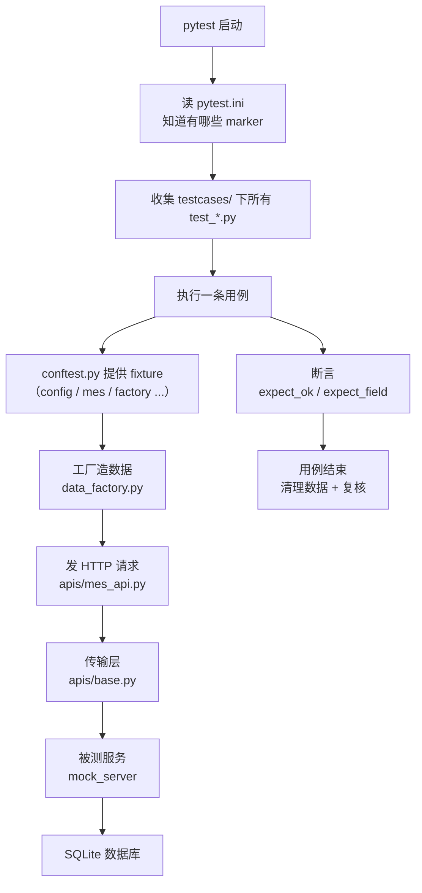
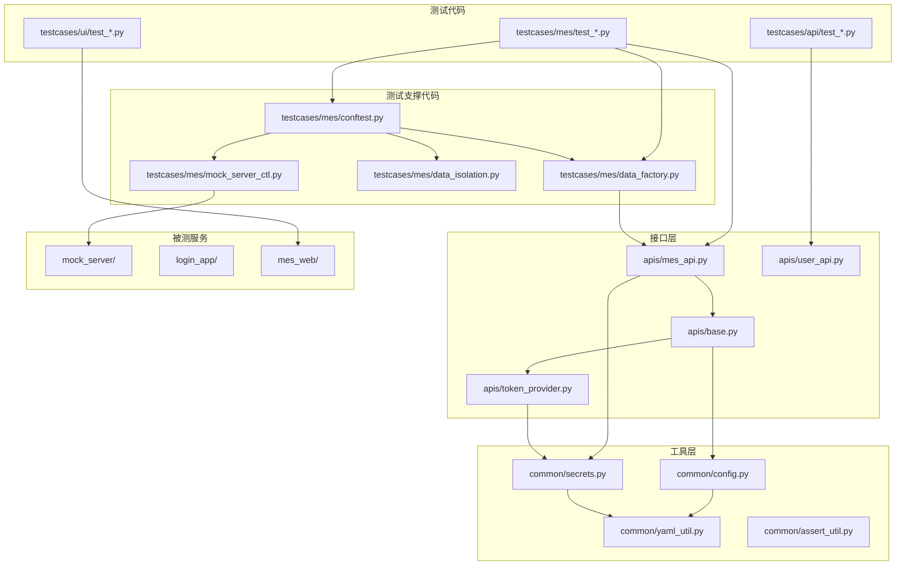

# 初学者完全入门：这个仓库是怎么转起来的

> **写给谁**：会用一点 Python、但没系统做过自动化测试的人。
> **读完你会知道**：一条用例从被 pytest 发现，到发出 HTTP 请求，到验证数据库，到最后清理数据，中间到底经过了哪些文件、哪些函数、为什么非要拆成这么多层。
>
> 这份文档不教你「怎么用这个仓库」（那看 [README](../README.md)），也不给你排学习计划（那看 [6 周学习路线](../从入门到面试的6周学习路线.md)）。它只回答一个问题：**这些文件彼此之间是怎么连起来的。**

---

## 目录

- [第 0 章 先建立一张地图](#第-0-章-先建立一张地图)
- [第 1 章 一条用例的完整一生](#第-1-章-一条用例的完整一生)
- [第 2 章 请求是怎么发出去的](#第-2-章-请求是怎么发出去的)
- [第 3 章 被测服务是怎么被拉起来的](#第-3-章-被测服务是怎么被拉起来的)
- [第 4 章 数据是怎么造出来又收回去的](#第-4-章-数据是怎么造出来又收回去的)
- [第 5 章 代码之间的依赖关系](#第-5-章-代码之间的依赖关系)
- [第 6 章 平台层在干什么](#第-6-章-平台层在干什么)
- [第 7 章 常见困惑逐个拆解](#第-7-章-常见困惑逐个拆解)
- [第 8 章 自己动手改一处，看它怎么传导](#第-8-章-自己动手改一处看它怎么传导)

---

## 第 0 章 先建立一张地图

### 0.1 这个仓库到底在测什么

初学者最容易卡住的第一个问题是：「这是个测试框架，那它测的是什么软件？」

答案是——**这个仓库自己带着被测试的软件**。它有四个被测对象：

| 被测对象 | 是什么 | 为什么需要它 |
|---|---|---|
| `mock_server/` | 一个小型 MES 后端（FastAPI + SQLite） | 真实业务系统不能拿来随便造数据，所以自己写一个 |
| `login_app/` | 一个带 6 个已知缺陷的登录服务 | 用来演示「怎么测出缺陷」 |
| `mes_web/` | 一个极简网页，把 `mock_server` 的数据渲染成 HTML | 用来演示「接口造数 → 网页操作 → 接口验证」这条链路 |
| `qaplat/` | 测试平台自己（门禁、度量、报表） | 平台层也有 bug，所以也要测 |

**关键认知**：`mock_server/`、`login_app/`、`mes_web/` 是「被测试的东西」，`testcases/` 才是「测试代码」。这两类代码混在一个仓库里，但角色完全相反。

### 0.2 五个目录，五种角色

```
apis/          发请求的地方（所有 HTTP 都从这里走）
testcases/     写断言的地方（只写"应该怎样"，不发裸请求）
ui/pages/      点网页的地方（元素定位全在这里）
common/        公共工具（读配置、读口令、统一断言）
qaplat/        测试平台（门禁/度量/报表，纯 Python 标准库）
```

再配上三个「被测试的服务」：

```
mock_server/   被测试的 MES 后端
login_app/     被测试的登录服务
mes_web/       被测试的网页
```

**为什么不能全塞进一个目录**：想象接口地址变了。如果用例里直接写 `requests.post("http://127.0.0.1:8321/api/v1/...")`，那这个地址在 50 个文件里各写了一遍，改一次要改 50 处。所以有了 `apis/` 这一层——地址只写在一处。

### 0.3 谁调用谁



这张图里有一条重要的规律：**箭头只能单向走**。`testcases/` 可以调 `apis/`，但 `apis/` 绝不反过来调 `testcases/`。这样每一层都可以单独测试。

---

## 第 1 章 一条用例的完整一生

我们拿仓库里最典型的一条用例走一遍。它在 [`testcases/mes/test_mes_smoke.py`](../testcases/mes/test_mes_smoke.py)。

### 1.1 先看代码本身

```python
def test_full_lifecycle_pending_to_shipped(self, factory, mes):
    order_no, body = factory.work_order(planned_qty="10.000")
    mes.expect_field(body, "status", "PENDING")

    body = mes.expect_ok(factory.approve(order_no))
    mes.expect_field(body, "status", "APPROVED")
    mes.expect_field(body, "reviewer", "planner01")
```

短短几行，但每一行背后都有一串文件在动。我们逐行拆。

### 1.2 `factory` 和 `mes` 是从哪来的

注意这条用例**没有自己创建** `factory` 和 `mes`。它们是 pytest 的 **fixture**（中文常译「夹具」）。

什么是 fixture？简单说就是：**函数签名里写个名字，pytest 就会自动把准备好的东西递给你**。

`factory` 和 `mes` 定义在 [`testcases/mes/conftest.py`](../testcases/mes/conftest.py)：

```python
@pytest.fixture(scope="session")
def mes_server(tmp_path_factory) -> MockServer:
    tmp_dir = tmp_path_factory.mktemp("mes")
    db_path = tmp_dir / "mes_session.db"
    server = MockServer(db_path=db_path, log_path=tmp_dir / "server.log")
    server.start()
    try:
        yield server
    finally:
        server.stop()


@pytest.fixture
def mes(mes_base_url) -> MesApi:
    return MesApi(mes_base_url)


@pytest.fixture
def factory(mes, mes_server) -> DataFactory:
    f = DataFactory(mes, mes_server.root_url, mes_server.db_path)
    yield f
    # …… 用例结束后清理数据（第 4 章详解）
```

**层层递进的关系**：

```
factory 需要 mes + mes_server
              │         │
              │         └── mes_server 需要 tmp_path_factory（pytest 内置）
              │                  └── 它会真的启动一个 uvicorn 进程
              └── mes 需要 mes_base_url
                        └── mes_base_url 需要 mes_server
```

这叫 fixture 的**依赖链**。pytest 会自动按正确顺序把整条链建起来，只建一次（`scope="session"` 表示整个会话共用一份）。

### 1.3 `scope` 到底是什么意思

这是新手最容易搞混的概念。看这三个：

| 写法 | 含义 | 生命期 |
|---|---|---|
| `scope="session"` | 整个测试会话只建一次 | 从第一个用例到最后一个用例 |
| `scope="function"`（默认） | 每条用例建一次 | 用例开始 → 用例结束 |

为什么 `mes_server` 用 session？因为**启动一个服务进程要 1~2 秒**，636 条用例每条都启一次就是二十分钟。

为什么 `mes` 用 function？因为每条用例应该拿到一个**干净的客户端**，上一条用例留下的 session、cookie 不能串到下一条。

**这个权衡是整个框架的缩影**：贵的、无状态的用 session；便宜的、有状态的用 function。

### 1.4 `factory.work_order()` 做了什么

跳到 [`testcases/mes/data_factory.py`](../testcases/mes/data_factory.py)。这个方法做了三件事：

```python
def work_order(self, planned_qty="5.000", product_code=None):
    order_no = self.next("WO")  # 1. 造一个唯一单号
    self.register_order(order_no)  # 2. 登记"这个待会儿要删"
    resp = self.mes.as_role("PLANNER").post(  # 3. 真的发请求建单
        "/work-orders",
        json={...},
    )
    ...
    return order_no, body
```

**第 2 步是精髓**。为什么要登记？因为用例会失败，而失败之后如果没人清理，数据就永久留在库里，下一轮测试的基线就对不上了。

这个设计叫「**登记-回收**」（register-cleanup）。它解决的问题是：

> 用例失败 → 断言抛异常 → 后面清理代码永远执行不到 → 数据残留

### 1.5 `mes.expect_ok()` 和直接 assert 有什么区别

看 [`apis/mes_api.py`](../apis/mes_api.py)：

```python
@classmethod
def expect_error(cls, resp, status: int, code: str | None = None) -> str:
    """断言"失败响应的状态码 + 业务 code"，返回 code 便于继续断言。"""
```

为什么不直接 `assert resp.status_code == 200`？因为**失败时的信息量**不同：

```python
# 直接断言，失败时你看到：
assert resp.status_code == 200
# AssertionError

# 用封装，失败时你看到：
mes.expect_ok(resp)
# AssertionError: 期望 200，实际 400；响应体：{"code":"INSUFFICIENT_STOCK","detail":{...}}
```

`expect_error` 更进一步——它要求同时断言**业务错误码**：

```python
mes.expect_error(resp, 400, "INSUFFICIENT_STOCK")
```

**为什么必须断业务码**：后端可能用 400 承载十几种不同原因（库存不足、状态非法、数量超计划…）。只断 400 的话，报告里它们长得一模一样，你根本分不清是哪个校验失效了。

### 1.6 整条用例的时间线

```
时间 ──────────────────────────────────────────────────►

pytest 收集      │ 发现 test_full_lifecycle_pending_to_shipped
                 │
建 session 级     │ mes_server: 启 uvicorn 进程 → 建库 → 灌种子数据
                 │
建 function 级    │ mes: new MesApi(base_url)
                 │ factory: new DataFactory(...)
                 │
用例开始          │ factory.work_order()  → POST /work-orders
                 │ factory.approve()     → POST /work-orders/{no}/approve
                 │ factory.add_batch()   → POST .../batches
                 │ ...
                 │ 每步都断言状态
                 │
用例结束          │ 【先】验流水余额链（第 4 章）
                 │ 【再】factory.cleanup()  删掉造的所有数据
                 │ 【再】factory.verify_clean() 复核真的删干净了
                 │
全部用例结束      │ data_isolation_check: 全部表行数 == 基线？
                 │ mes_server: 停 uvicorn 进程
```

**注意最后清理的顺序**——这是这个仓库最讲究的地方之一，第 4 章专门讲。

---

## 第 2 章 请求是怎么发出去的

### 2.1 三层结构

一个 HTTP 请求要经过三层：

```
用例                mes.expect_ok(factory.approve(order_no))
                        │
业务接口层           MesApi.approve()  →  client.post(f"/work-orders/{no}/approve")
apis/mes_api.py         │
                        │
传输层               BaseApi.request()  →  session.request("POST", url, ...)
apis/base.py            │  超时/重试/日志/代理/鉴权都在这
                        │
                        └──► 真的 HTTP 请求
```

**为什么要分两层**：`BaseApi` 管「怎么发」，`MesApi` 管「发什么」。换域名只动 `BaseApi`，改接口路径只动 `MesApi`，用例永远不用改。

### 2.2 `BaseApi.request()` 的完整流程

这是全仓最复杂的一个函数，在 [`apis/base.py:159`](../apis/base.py#L159)。把它拆开看：

```python
for attempt in range(self.retries + 1 + REAUTH_EXTRA_ATTEMPTS):
    # ① 判断这次要不要绕过代理
    if attempt > 0 and last_attempt_transport_failure and os.getenv("API_TRUST_ENV", "1") == "1":
        req_kwargs = {**kwargs, "proxies": {"http": None, "https": None}}

    # ② 取令牌（每次都重新取，不是循环外取一次）
    if token_source is not None:
        req_kwargs, used_token = self._with_token(req_kwargs, token_source)

    # ③ 真的发请求
    try:
        response = self.session.request(method, url, **req_kwargs)
    except (requests.ConnectionError, requests.Timeout) as exc:
        last_error = exc
        last_attempt_transport_failure = True  # 记住"这次是传输失败"
        if attempt < self.retries:
            self._sleep(self._retry_wait(attempt))  # 退避等待
            continue
        raise

    # ④ 拿到响应，复位代理判断
    last_attempt_transport_failure = False

    # ⑤ 判断要不要换令牌重放（401）
    # ⑥ 判断要不要按状态码重试
```

**这里有四个新手会忽略的细节**：

**细节 1：为什么 `proxies` 判断要看「上一次尝试」而不是「曾经失败过」**

假设序列是：传输失败 → 500 → 200。

- 第 1 次：传输失败（可能代理掐了 TLS）→ 标记为 True
- 第 2 次：绕过代理，但拿到 500（说明服务端能连通，代理不是问题）→ **复位为 False**
- 第 3 次：应该用回用户配的代理，而不是继续绕过

如果写成「曾经失败过就一直绕过」，用户的代理会在后续所有重试里静默失效。

**细节 2：为什么 `Retry-After` 要支持两种格式**

```
Retry-After: 2                                    ← delta-seconds
Retry-After: Wed, 21 Oct 2026 07:28:00 GMT        ← HTTP-date
```

两种都合法（RFC 9110）。只支持第一种的话，第二种会「默默退回退避」——没人会注意到。

**细节 3：为什么抖动只往上加**

```python
wait *= 1 + self._rng.uniform(0, RETRY_BACKOFF_JITTER_RATIO)  # 只乘 (1, 1.25)
```

如果写成 `uniform(0.75, 1.25)`，等待可能变成 0.375s——**比改造前的 0.5s 更短**，等于偷偷对服务端加压了。

**细节 4：为什么 `Retry-After: 3600` 要被截断**

服务端说「一小时后再来」，但一条回归用例等一小时是不可接受的。所以有 `DEFAULT_MAX_RETRY_WAIT = 30.0`。

### 2.3 令牌为什么要单独一个文件

[`apis/token_provider.py`](../apis/token_provider.py) 管的是「什么时候该换令牌」。

最朴素的实现是：每次请求前检查是否快过期，是就登录一次。但并发时会出问题——10 个线程同时发现过期，会登录 10 次。

它的解法是「**快路径无锁 + 进锁后比对 generation**」：

```python
def refresh(self) -> str:
    if self._token is not None and not self.is_expiring():
        return self._token  # 快路径：不加锁，绝大多数请求走这里
    with self._lock:
        if self._generation != generation_seen:  # 别人已经刷过了
            return self._token
        # 真的登录
        self._generation += 1
```

**为什么这很重要**：这个模式（double-checked locking）在真实的高并发系统里到处都在用。面试问到「怎么保证并发只初始化一次」时，这就是标准答案。

---

## 第 3 章 被测服务是怎么被拉起来的

### 3.1 为什么测试代码要负责启动服务

理论上应该有个「测试环境」已经跑着服务，测试只负责发请求。但这个仓库选择**自己启动**，原因有三：

1. **可重复**：每次都是全新数据库，不会有上次残留的数据
2. **可并行**：每个测试会话用随机端口，两个会话同时跑不冲突
3. **可控**：可以给服务传特殊参数（比如让令牌 1 秒过期）

### 3.2 `MockServer` 类的三层启动逻辑

看 [`testcases/mes/mock_server_ctl.py`](../testcases/mes/mock_server_ctl.py)：

```python
server = MockServer(db_path=..., port=None, concurrency_window_ms="300", reset=True)
server.start()
```

`start()` 内部做了五件事：

```
① 分配端口        free_port() —— 让操作系统给一个空闲端口
② 组装命令        python -m scripts.service_launcher mock_server.run --port ... --db ...
③ 启动子进程      subprocess.Popen(..., creationflags=CREATE_NEW_PROCESS_GROUP)
④ 等它健康        _wait_healthy() —— 轮询 /api/v1/healthz
⑤ 核对数据库路径  断言 healthz 返回的 database == 我传进去的 db_path
```

**第 ⑤ 步为什么必须有**：这是历史上踩过的坑。如果服务连错了数据库（比如用了默认路径而不是临时目录），测试**照样全绿**——因为它测的是另一份数据。这种「静默连错库」比直接报错危险一百倍。

### 3.3 为什么要一个 `service_launcher.py`

[`scripts/service_launcher.py`](../scripts/service_launcher.py) 只有几十行，但它解决的问题很精妙：

```python
def install_signal_absorbers() -> list[int]:
    """先装「只记录不退出」的信号处理器。"""
```

**问题**：覆盖率采集需要在进程退出时把数据写入磁盘（`atexit`）。但 uvicorn 收到停止信号时，会自己处理并直接退出，**走不到 `atexit`**。

**解法**：外面套一层启动器，先接管信号（记下但不退出），让 uvicorn 的 `main()` 正常返回，于是 `atexit` 就会被执行，覆盖率数据就能落盘。

这就是 [`testcases/mes/test_coverage_collection.py`](../testcases/mes/test_coverage_collection.py) 要验证的东西——它甚至断言「分片里必须有真实执行行」，因为 Windows 上 `terminate` 会产生**空壳分片**（文件存在但零数据）。

### 3.4 停止服务为什么要三段式

```python
def stop(self, timeout: float = 10.0):
    # 第一段：优雅（CTRL_BREAK_EVENT / SIGTERM），等 10 秒
    # 第二段：terminate()，等 10 秒
    # 第三段：kill / taskkill /F /T
```

**为什么不能直接 kill**：Windows 的 `terminate()` 是 `TerminateProcess`，它会立刻杀掉进程，`atexit` 跑不到，覆盖率数据丢失。

**为什么还要有第三段**：进程可能卡死，不 kill 就会留下僵尸占着端口，让后面所有测试失败。

---

## 第 4 章 数据是怎么造出来又收回去的

这是整个仓库**最值得学的部分**，也是最容易被初学者抄错的部分。

### 4.1 三层防线

```
第一层：每条用例自己清（factory.cleanup）
第二层：整个会话结束时比对基线（data_isolation_check）
第三层：跨会话的过期数据清理（data_ttl.purge）
```

为什么要三层？因为每层只能抓到某些类型的泄漏：

| 泄漏类型 | 第一层 | 第二层 | 第三层 |
|---|---|---|---|
| 用例造的数据没删 | ✅ 能抓 | ✅ 能抓 | ✅ 能抓 |
| 领料了没退料 | ❌ 行数不变 | ✅ 库存合计变了 | ✅ |
| 上次 CI 跑崩了留的数据 | ❌ 不归它管 | ❌ 每次是新库 | ✅ 按时间清 |

### 4.2 第一层的清理顺序为什么这么绕

看 [`testcases/mes/conftest.py:88`](../testcases/mes/conftest.py#L88) 的 teardown：

```python
f = DataFactory(mes, mes_server.root_url, mes_server.db_path)
yield f

chain_errors = ledger_balance_chain_errors(mes_server.db_path)  # 【先】验流水链
cleanup_error = None
try:
    actions = f.cleanup()  # 【中】清理
except BaseException as exc:
    actions = []
    cleanup_error = exc
try:
    residues = f.verify_clean()  # 【后】复核
except BaseException as exc:
    residues = []
    if cleanup_error is None:
        cleanup_error = exc

assert not residues, "用例结束时数据没有回收干净 —— ..."
assert not chain_errors, "流水账面余额与实际库存对不上（账实不符）—— ..."
```

**三个「为什么」**：

**① 为什么先验流水链，再清理**

`cleanup()` 会把用例自己造的流水行删掉。等删完了再验，就是 0 条对 0 条，恒为绿——**什么也验不出来**。

流水只增不改，行还在的时候是唯一能验它的时点，而这个时点就在清理之前。

**② 为什么用 `try/finally` 包住 cleanup**

早期版本是「先断言流水链、再 cleanup()」的直线代码。后果是：断言一旦失败，`cleanup()` 那行就永远走不到，用例造的数据全留在库里。真正的原因（账实不符）反而被「会话收尾行数对不上」这层噪声盖住了。

**③ 为什么清理失败还要 `raise cleanup_error`**

吞掉就等于让「数据没删干净」这件事永远不可见。而这恰恰会在下一轮变成一句莫名其妙的基线漂移。

### 4.3 第二层：为什么要看数值，不能只看行数

看 [`testcases/mes/data_isolation.py`](../testcases/mes/data_isolation.py) 的 `snapshot()`：

```python
def snapshot(db_path) -> dict:
    return {
        "rows": row_counts(db_path),  # 8 张表各多少行
        "totals": column_totals(db_path),  # 5 个关键数值列的合计
    }
```

**为什么要数值**：领料操作是 `UPDATE stock SET available = available - 7`，**行数一行都没变**。如果只比行数，这个泄漏永远抓不到。

### 4.4 第三层：流水余额链怎么验

这是最精妙的一个。流水表长这样：

| id | material_code | type | qty_milli | balance_milli |
|---|---|---|---|---|
| 1 | MAT-CU-001 | RECEIPT | +120000 | 120000 |
| 2 | MAT-CU-001 | ISSUE | -7000 | 113000 |

**判据**：第 i 条的 `balance_milli` 必须等于第 i-1 条的 `balance_milli` 加上本条的有符号数量。

**期初值从哪来**：不硬编码。用 `期初 = 当前可用量 - 全部流水净变化` 反推。这样即使种子数据改了也不会假失败。

**为什么这条最值钱**：「账实不符」是线上最高发的一类问题，而它**在任何单接口测试里都看不出来**——每个接口都返回 200，但账本已经错了。

---

## 第 5 章 代码之间的依赖关系

### 5.1 三个 `conftest.py` 的分工

这是新手最困惑的地方：为什么有好几个 conftest？

```
conftest.py                          ← 根目录，全仓生效
testcases/mes/conftest.py            ← 只在 testcases/mes/ 下生效
testcases/login/conftest.py          ← 只在 testcases/login/ 下生效
testcases/ui/conftest.py             ← 只在 testcases/ui/ 下生效
```

**pytest 的规则**：conftest.py 对**它所在目录及子目录**生效。

所以 `testcases/mes/conftest.py` 里的 `mes_server` fixture，**在 `testcases/ui/` 里是拿不到的**。这解释了为什么 [`test_mes_mixed_flow.py`](../testcases/ui/test_mes_mixed_flow.py) 要自己写一套 `mixed_mock_server`：

```python
@pytest.fixture(scope="session")
def mixed_mock_server(tmp_path_factory) -> Iterator[MockServer]:
    """两个服务在这里自建 fixture：testcases/ui/ 看不到
    testcases/mes/conftest.py 的 mes_server（conftest 只对自己的目录及以下生效）。"""
```

### 5.2 为什么源码包叫 `apis` 不叫 `api`

这是个 **30 秒能看懂、但会坑人一整天**的坑。

假设源码包叫 `api/`，测试目录叫 `testcases/api/`。pytest 会把 `testcases/api/` 插进 `sys.path`，于是 `import api` 会**静默**解析到测试目录，报一个看不懂的错：

```
ImportError: cannot import name 'MesApi' from 'api'
```

解法：源码包换个名字，叫 `apis`。见 [`apis/__init__.py`](../apis/__init__.py) 的说明。

### 5.3 `sys.path` 为什么要在 conftest 里手动插

看 [`conftest.py:33`](../conftest.py#L33)：

```python
for _p in (ROOT_DIR, TESTCASES_DIR, LOGIN_DIR, MES_DIR):
    if str(_p) not in sys.path:
        sys.path.insert(0, str(_p))
```

**为什么不能靠 pytest 自动处理**：`pytest` 和 `python -m pytest` 两种调用方式下，pytest 插入 `sys.path` 的行为**不一样**。依赖隐式行为的结果是「本机跑得好、CI 上 ModuleNotFoundError」。

### 5.4 模块依赖图



**读这张图的规律**：

- **箭头只向下、不向上**：测试永远不 import 被测服务的源码（`testcases/` 从不 `from mock_server import ...`）
- **为什么**：如果测试 import 了被测代码的模块，那"测试通过"可能只是因为测试和服务用的是同一份错误的实现
- **例外**：`data_isolation.py` 会直接连 SQLite 查库——这是刻意的，因为「验证数据库状态」必须绕开服务端

---

## 第 6 章 平台层在干什么

### 6.1 为什么需要平台层

如果只有 `testcases/`，你能回答「测试过没过」。但你回答不了：

- 这次失败是**新引入的**还是**一直失败的**？
- 接口改了字段，**有测试覆盖到吗**？
- 这个用例上次跑是什么时候，**稳定吗**？
- 覆盖率**降了吗**？

`qaplat/` 就是回答这些问题的。

### 6.2 六个模块的分工

```
qaplat/paths.py      算出所有路径（仓库根、缓存目录、数据库路径）
qaplat/_dump.py      pytest 插件，一次运行拿到三样东西
qaplat/registry.py   用例 ↔ 接口 的覆盖矩阵
qaplat/metrics.py    度量数据库（SQLite）
qaplat/gate.py       四层门禁
qaplat/report.py     静态 HTML 报表
```

**依赖是严格单向的**：`paths` 和 `metrics` 是叶子（不 import 同包任何模块），`report` 在最后。

### 6.3 `_dump.py` 为什么是唯一采集入口

它是 pytest 的一个插件，用 `-p qaplat._dump` 加载。一次运行同时产出：

```python
_STATE = {
    "cases": [],  # 每条用例的结果
    "markers": {},  # 每个 nodeid 有哪些 marker
    "files": {},  # 每个 nodeid 来自哪个文件
}
```

**为什么要一次拿三样**：如果分三次跑（一次收集结果、一次收集 marker、一次收集文件），慢三倍，而且可能拿到不一致的快照。

### 6.4 门禁的四层与 `max_errors`

| 层 | marker 表达式 | 最低通过率 | 最大 error |
|---|---|---|---|
| smoke | `smoke` | 1.0 | 0 |
| pr | `smoke or api or platform` | 1.0 | 0 |
| nightly | `not ui` | 0.98 | 3 |
| release | 空（全部） | 0.95 | 5 |

**`max_errors` 是为堵一个具体漏洞加的**：

```python
pass_rate = passed / (passed + failed)  # 注意分母里没有 error
```

于是 `30 passed + 6 error` 会算出 **100% 通过率**——明明有 6 条用例压根没跑成，却报告完美通过。`max_errors=0` 就是不让这种情况发生。

### 6.5 门禁自己也被测试

这是最值得抄的一点。[`testcases/contract/test_contract_export.py`](../testcases/contract/test_contract_export.py) 里有三条：

```python
def test_export_script_check_reports_no_drift():
    """正常情况：退出码 0，输出 [一致]。"""


def test_export_script_detects_tampered_file():
    """故意把 spec 改坏：必须退出码 1，输出 [漂移]。"""


def test_export_script_detects_missing_file():
    """把 spec 删掉：必须报"不存在"。"""
```

**为什么需要这个**：门禁如果从来没人验证过它真的会拦，那它本身就成了新的假绿来源——它可能一直返回 0，而所有人都以为它在把关。

---

## 第 7 章 常见困惑逐个拆解

### 7.1「为什么测试里看不到 `requests`」

```python
# 用例里从来不这样写
resp = requests.post("http://127.0.0.1:8321/api/v1/work-orders", json={...})

# 而是这样
resp = factory.work_order()
```

**原因**：裸 `requests` 没有超时（会卡死流水线）、没有日志（失败无法回溯）、地址写死（换环境要改所有用例）。

### 7.2「`yield` 是什么」

```python
@pytest.fixture
def factory(mes, mes_server):
    f = DataFactory(...)
    yield f  # ← 分界线
    # 这里是用例结束后执行的清理
```

`yield` 之前是**准备**，`yield` 之后是**收尾**。pytest 会把 `yield` 出来的值递给用例，等用例跑完再回来执行后面的代码。

即使用例失败，`yield` 后面的代码**也会执行**——这就是为什么清理要写在 `yield` 后面。

### 7.3「`@pytest.mark.smoke` 有什么用」

它给用例打标签，然后可以用 `-m` 筛：

```powershell
pytest -m smoke          # 只跑冒烟
pytest -m "not ui"       # 跑除 UI 外的全部
pytest -m "mes and not smoke"   # 组合条件
```

`pytest.ini` 里开了 `--strict-markers`，所以**写错标签会直接报错**，不会静默忽略。

### 7.4「为什么有 11 条 xfailed」

`xfail` 表示「这条用例预期会失败」。11 条对应 4 个已知契约缺陷（DEF-01、02a、02b×6、03×2）。

**用 `strict=True` 的原因**：如果哪天缺陷被修好了，这条用例会变成 XPASS（意外通过），于是**立刻报红**——逼着你回来更新缺陷清单。

**为什么不用「断言期望 422」**：那样会常年红着，团队学会忽略它，真回归也就看不见了。

### 7.5「`login_app` 的缺陷用例为什么是绿的」

因为它们断言的是「**当前确实有这个问题**」，不是「期望它被修好」：

```python
def test_lc02_any_username_can_login(self, login_api):
    """FIND-01：任意用户名 + 正确密码都能登录。"""
    resp = login_api.login_json("完全不存在的用户", PASSWORD)
    assert resp.status_code == 200
    assert resp.json()["user"] == "完全不存在的用户"
```

如果哪天有人修了 FIND-01，这条用例会红——**这正是设计意图**，它在告诉你「行为变了，去更新缺陷清单」。

### 7.6「`conftest.py` 和普通模块有什么区别」

| | `conftest.py` | 普通模块 |
|---|---|---|
| 需要 import 吗 | ❌ 不需要，自动生效 | ✅ 需要 |
| 生效范围 | 所在目录及子目录 | 谁 import 谁用 |
| 能提供 fixture 吗 | ✅ | ❌ |

---

## 第 8 章 自己动手改一处，看它怎么传导

理解一个系统最快的方法，是改坏它，看哪里会红。

### 实验 1：改坏被测服务，看用例能不能抓到

打开 [`mock_server/services.py`](../mock_server/services.py#L54)，找到状态机定义：

```python
ALLOWED_TRANSITIONS = {
    "PENDING": ("APPROVED", "CANCELLED"),
    "APPROVED": ("SCHEDULED", "CANCELLED"),
    ...
}
```

**先做一个会红的实验**，把 `APPROVED` 的排产能力去掉：

```python
"APPROVED": ("CANCELLED",),      # 原来有 "SCHEDULED"
```

然后：

```powershell
pytest -m mes -q
```

**实测结果**（真的跑过）：

```
FAILED testcases/mes/test_mes_business.py::TestStateMachine::test_ship_completed_order_without_stock_in_is_rejected
FAILED testcases/mes/test_mes_business.py::TestStateMachine::test_complete_without_quality_pass_is_rejected
FAILED testcases/mes/test_mes_business.py::TestStateMachine::test_report_beyond_planned_quantity_is_rejected
FAILED testcases/mes/test_mes_smoke.py::TestMesSmoke::test_full_lifecycle_pending_to_shipped
================ 4 failed, 60 passed, 572 deselected in 43.28s ================
```

4 条红。冒烟那条最关键——它证明「主流程真的被走了一遍」，而不是分散的单接口测试各自绿。

**再做一个不会红的实验**，这次把 `PENDING` 的取消能力去掉：

```python
"PENDING": ("APPROVED",),        # 原来有 "CANCELLED"
```

**实测结果**：`64 passed`，**全绿**。

> ⚠️ **这是一个真实的覆盖缺口，不是文档写错了。**
> `POST /work-orders/{order_no}/cancel` 这个接口在 `mock_server/routers.py:509` 有实现，
> 在 `spec_contract.py:92` 有权限声明，但 `testcases/mes/` 下**没有任何用例调用它**。
> 状态机有四条边通向 `CANCELLED`（PENDING/APPROVED/SCHEDULED/IN_PROGRESS），
> 全部没有用例覆盖。
>
> **这说明什么**：`-m mes` 的 64 条用例全绿，并不等于「MES 的业务逻辑都被验证过」。
> 这个仓库声称「状态机用例可以参数化遍历 `ALLOWED_TRANSITIONS` 做非法跃迁全覆盖」
> （见 `services.py` 的模块 docstring），但**实际没做到**——只有
> `test_approve_an_already_approved_order_is_rejected` 等两三条单点用例。
>
> **这正好是给初学者的第一课**：绿色的测试套件不等于被验证过的系统。
> 找缺口的办法就是「改坏它，看谁变红」。
>
> **想贡献的第一件事**：给 `CANCELLED` 补用例。覆盖矩阵的用法见
> [`docs/platform-usage.md`](platform-usage.md)（`qaplat registry` 子命令），
> 用例与接口的对应关系见 [README 的「用例覆盖」一节](../README.md#用例覆盖)。

> ⚠️ 两个实验做完都要把 `services.py` 改回来。`git status` 应该是干净的。

### 实验 2：让一条用例漏清理，看三层防线哪层会响

新建一个临时文件 `testcases/mes/test_zz_temp_leak_probe.py`，绕开工厂直接造数据：

```python
import pytest

pytestmark = [pytest.mark.mes, pytest.mark.api]


def test_leak_probe_temp(mes):
    resp = mes.as_role("PLANNER").post(
        "/work-orders",
        json={
            "order_no": "WO-LEAK-TEMP",
            "product_code": "FG-01",
            "product_name": "成品一",
            "planned_qty": "1.000",
        },
    )
    assert resp.status_code == 201, resp.text
```

跑它：

```powershell
pytest testcases/mes/test_zz_temp_leak_probe.py -q
```

**实测结果**（真的跑过）：

```
1 passed, 1 error in 2.66s

E     {'counts': {'users': 5, 'materials': 5, 'work_orders': 0, 'production_batches': 0, ...}}
    != {'counts': {'users': 5, 'materials': 5, 'work_orders': 1, 'production_batches': 0, ...}}
E     Use -v to get more diff

testcases/mes/conftest.py:158: AssertionError
```

**注意这个结果的样子**：`1 passed` 和 `1 error` 同时出现。

- **用例本身 passed** —— 因为 POST 确实返回了 201，断言成立
- **会话收尾 error** —— `data_isolation_check` 发现 `work_orders` 从 0 变成了 1

这就是第二层防线在起作用。如果只有第一层（用例自己清理），这个泄漏会被完美地漏过去。

> 💡 **顺带一个坑**：`product_name` 是必填的。少传它会拿到 422 而不是 201，
> 于是断言先红、探针根本没造出数据，你会误以为隔离检查没生效。
> 这跟第 8 章实验 1 里「取消功能没覆盖」是同一类教训：**探针自己也要写对**。
>
> 仓库里真正的泄漏探针是 [testcases/mes/_leak_probe.py](../testcases/mes/_leak_probe.py)，
> 由 `test_data_lifecycle.py` 用子进程调用——因为泄漏检查是会话级的，
> 必须在**独立进程**里跑才能观测到。

### 实验 3：把权限检查去掉，看双向断言怎么抓

打开 [`mock_server/deps.py`](../mock_server/deps.py)，把 `require_permission` 里的检查注释掉：

```python
def require_permission(action: str):
    def _check(current: CurrentUser = Depends(get_current_user)) -> CurrentUser:
        # current.require(action)      # ← 注释掉这一行
        return current

    return _check
```

然后：

```powershell
pytest testcases/mes/test_mes_business.py -q -k permission
```

**预期**：权限矩阵 9 条全部红——因为「不在允许集合的角色必须 403」这个方向再也拿不到 403 了。

**为什么它能抓到**，关键在于用例是**双向断言**的：

```python
if role in allowed:
    assert resp.status_code != 403  # 该放的不能拒
else:
    assert resp.status_code == 403  # 该拒的必须拒
    assert mes.error_code(resp) == "PERMISSION_DENIED"
```

只测后一个方向的用例，会在「权限被收得过紧、正常角色也做不了事」时放行。

> 💡 **这里有一个极易搞反的细节，值得单独记住。**
>
> 你可能以为「请求体缺字段 → 422 发生在权限检查之前」。**错了，实测是反的**：
>
> ```
> 无权限 + 缺字段  → 403 PERMISSION_DENIED
> 有权限 + 缺字段  → 422 REQUEST_VALIDATION_ERROR
> ```
>
> 原因是权限检查写成了 FastAPI 的 `Depends`，而 `Depends` **先于**请求体校验执行。
> [`mock_server/deps.py`](../mock_server/deps.py) 的 docstring 解释了为什么要这样：
> 如果权限检查写在函数体第一行，它就会排在 422 之后，于是越权者可以靠
> 「422 还是 403」的差异**逐个字段探测接口结构**。
>
> **这个细节的实际后果**：`test_permission_matrix` 里登记回收的条件是
> `resp.status_code == 201`。如果请求体缺字段，有权限的 ADMIN 拿到 422 而不是 201，
> 登记就不会发生，建出来的数据没人回收——而用例本身还是绿的。
> 这个 bug 真实存在过，见第 8 章末尾的说明。

### 实验 4：改一个数字，看文档一致性门禁

打开 [`pytest.ini`](../pytest.ini)，给 markers 加一个新的（比如 `mytest: 我的测试`），但**不改** [`docs/质量门禁策略.md`](../docs/质量门禁策略.md)，然后：

```powershell
python scripts/check_gate_policy.py
```

**实测结果**（真的跑过）：

```
[gate-policy] 不一致 1 项：
  - marker mytest（pytest.ini 第 21 行声明了它，策略文档的 marker 表里没有归属——这个 marker 没人管）
[gate-policy] 策略文档与 workflow / pytest.ini 已经分叉，请让两边重新说同一件事。
退出码: 1
```

这就是「文档即门禁」——文档里的承诺如果有人没实现，脚本会拦。

**注意报错文案的设计**：它不是简单说「不一致」，而是告诉你**具体哪个 marker、在哪个文件的第几行、缺了什么**。这是可操作的报错，而不是让人去猜。

> 💡 改完记得把 `pytest.ini` 恢复，否则 CI 会一直红。

### 8.5 一个真实修过的 bug：绿着的用例在偷偷漏数据

这一节讲一个**真实修过**的问题。它几乎把所有前面讲的概念串起来了，所以值得完整看一遍。

#### 症状（注释里记录的）

`data_factory.py` 的 `register_material()` docstring 里记着一条实测教训：

> 权限矩阵那条用例在 ADMIN/PLANNER 两个角色上都真的建出了 MAT-ACL，
> 而它没走工厂方法 —— 会话收尾就报 materials 多 2 行、stock 多 1 行。

于是后来加了一行「建成功了就登记回收」的逻辑。

#### 代码层面的问题

权限矩阵是数据驱动的，第一行原本是这样：

```python
(("新建物料", "POST", "/materials", ("ADMIN", "PLANNER"), {"material_code": "MAT-ACL", "name": "权限用例"}),)
```

而 `POST /materials` 的请求体有 **5 个必填字段**：

```python
material_code / name / category / unit / unit_price
```

只给了 2 个。**实测**（用原始的 2 字段请求体分别发一次）：

```
ADMIN    → 422 REQUEST_VALIDATION_ERROR
PLANNER  → 422 REQUEST_VALIDATION_ERROR
```

一个 201 都没有。

再看用例里登记回收的那一行：

```python
if method == "POST" and path == "/materials" and material_code and resp.status_code == 201:
    factory.register_material(material_code)
```

**`resp.status_code == 201` 这个条件在当前状态下永远不成立**，所以登记那一行永远不执行。

#### 三条路线，必须走完才知道真相

这里最能说明「为什么不能靠推理修 bug」：

| 路线 | 做法 | 结论 |
|---|---|---|
| A. 推理 | 「缺字段 → 422 → 没建出数据 → 不会泄漏」 | 看起来没问题 |
| B. 读注释 | docstring 说「真的建出了 MAT-ACL，多 2 行」 | 与 A 矛盾 |
| C. **实测** | 用 2 字段版本真跑 `pytest -m mes` | **`64 passed`，零泄漏** |

**实测（C）是唯一的裁决者**。当前代码下，原始的 2 字段版本**不会**产生泄漏——因为 422 拦住了创建，压根没有数据需要回收。

那 docstring 里那句「多 2 行」是什么？它是**更早版本的实测记录**。历史演进大概是：

1. 最早矩阵请求体完整 → ADMIN/PLANNER 各建一条 `MAT-ACL` → 真的多 2 行（docstring 记的就是这一刻）
2. 后来加了「建成功就登记」的修复
3. 再后来被测服务补齐了必填字段校验（`MaterialCreateIn` 从最早提交起就是 5 个必填字段，但早期的路由可能没严格执行），2 字段请求体开始稳定返回 422

> ⚠️ **第 3 步我只能确认「当前是 5 个必填」，无法从 git 历史精确复原它是哪一次变更开始严格执行的**。
> 这个仓库的 `mock_server/schemas.py` 在当前可见的历史里一直有 5 个字段，
> 所以更可能是「请求体校验一直很严，docstring 描述的是更早的、schema 还没这么严的版本」。
> 不编造细节，只记结论。

#### 所以这次修复的价值是什么

**它不是「修了一个正在发生的泄漏」，而是「让这段代码不再依赖一个侥幸成立的条件」。**

- 修之前：靠「反正 422 会拦住」而恰好不泄漏
- 修之后：ADMIN 真的拿到 201，登记回收**真的执行了一次**

这就从「碰巧正确」变成了「结构上正确」。如果哪天有人放宽了 `MaterialCreateIn` 的必填约束（比如给 `category` 加默认值），修之前的代码会立刻开始泄漏，而修之后不会。

#### 这个案例教了初学者什么

| 教训 | 对应章节 |
|---|---|
| 「用例绿」不等于「没有副作用」 | 第 4 章 |
| 数据驱动测试的数据表本身会腐化 | 本节 |
| 数据隔离的第二层防线是真的会兜底的 | [4.1](#41-三层防线) |
| **注释里的历史记录不等于当前行为** | 本节路线 A/B/C |
| 报错信息可能指向错误的方向（说「库存没退回」，其实是「根本没建成功」） | 第 4 章 |
| 403 和 422 的先后顺序容易搞反，必须以实测为准 | [实验 3](#实验-3把权限检查去掉看双向断言怎么抓) |

#### 顺便记住一个反直觉结论

我一开始把根因写成「422 发生在权限检查之前」。**这是错的**，实测推翻了它：

```
无权限 + 缺字段  → 403    ← 权限 Depends 先执行
有权限 + 缺字段  → 422    ← 然后才是请求体校验
```

**教训**：写注释时不要把「推测」写成「事实」。这个仓库的 [`mock_server/deps.py`](../mock_server/deps.py) docstring 里早就写明了正确顺序，但我是**先实测、后去读它**才发现的。如果只读代码不实测，很可能会写出一个似是而非的解释，然后被后人当真。

---

## 附录 A 术语表

| 术语 | 一句话解释 |
|---|---|
| **fixture** | pytest 里「自动准备好的东西」，函数参数写名字就能拿到 |
| **scope** | fixture 的生命期（session 全局 / function 每条用例） |
| **marker** | 给用例打的标签，用于 `-m` 筛选 |
| **conftest.py** | 自动生效的配置和 fixture 文件，按目录层级继承 |
| **xfail** | 预期失败；`strict=True` 时变成 XPASS 会报红 |
| **mock** | 假的被测对象（本仓库的 `mock_server` 是这个意思） |
| **幂等** | 同样的请求发多次，结果一样 |
| **乐观锁** | 用 version 号检测并发冲突，不真的加锁 |
| **冒烟测试** | 最快的核心链路验证，提交前必跑 |
| **契约测试** | 验证接口的「形状」（字段名、类型、状态码）没变 |
| **属性测试** | 给一个规则，让机器自动生成大量数据去撞 |
| **覆盖率** | 代码被执行到的比例 |
| **门禁** | 不达标就不让合并的检查 |

## 附录 B 文件速查

| 我想… | 去这个文件 |
|---|---|
| 改接口地址 | [`data/config.yaml`](../data/config.yaml) |
| 改口令 | [`.env`](../.env.example)（从 example 复制） |
| 加一条接口用例 | [`testcases/api/`](../testcases/api/) |
| 加一条业务用例 | [`testcases/mes/test_mes_business.py`](../testcases/mes/test_mes_business.py) |
| 加一个页面元素 | [`ui/pages/`](../ui/pages/) |
| 改断言方式 | [`apis/mes_api.py`](../apis/mes_api.py) 的 `expect_*` |
| 改超时/重试 | [`apis/base.py`](../apis/base.py) 顶部常量 |
| 改门禁阈值 | [`qaplat/gate.py`](../qaplat/gate.py) |
| 看缺陷清单 | [`docs/defects.md`](defects.md) |
| 看为什么这么设计 | [`docs/测试有效性说明.md`](测试有效性说明.md) |

## 附录 C 推荐阅读顺序

如果你想彻底搞懂这个仓库，按这个顺序读代码（不是读文档）：

```
1. pytest.ini                              ← 5 分钟，知道有哪些 marker
2. conftest.py                             ← 10 分钟，知道全局有什么
3. testcases/login/test_login_contract.py   ← 30 分钟，最简单的一条完整用例
4. testcases/login/conftest.py              ← 15 分钟，看 fixture 怎么起服务
5. login_app/app.py                         ← 20 分钟，看被测服务长什么样
6. apis/base.py                             ← 1 小时，最复杂的传输层
7. testcases/mes/conftest.py                ← 30 分钟，数据隔离的精髓
8. testcases/mes/data_factory.py            ← 30 分钟，造数与回收
9. mock_server/services.py                  ← 1 小时，业务规则核心
10. qaplat/gate.py                          ← 30 分钟，门禁逻辑
```

**为什么不从 `mock_server` 开始**：业务代码有 2000 多行，没有测试经验时读它容易迷失在细节里。先看「怎么测」，再看「被测什么」。

---

## 一句话总结

这个仓库的核心思想是：**不要相信任何「自动通过」的结论，除非你能证明那个结论本身是可信的。**

所以它有：

- 数据三层隔离 → 证明「测完真的清干净了」
- 并发区间交叠 → 证明「请求真的同时跑了」
- 覆盖率分片验证 → 证明「覆盖率数据是真的」
- 门禁自我测试 → 证明「门禁真的会拦」
- 11 条 xfail 哨兵 → 证明「缺陷清单没漂移」

**这就是它和「一堆写好的测试用例」的区别。**
