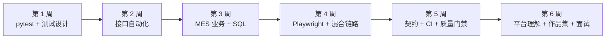
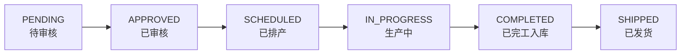
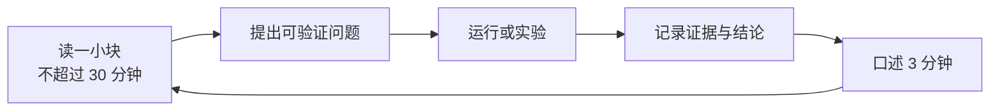

# 从入门到面试：fullstack-test-framework 学习路线

> 适用对象：有 Linux、SQL 基础，Python 和自动化测试尚未系统做过，计划每天投入约 8 小时，以自动化测试岗位为目标。
>
> 学习目标不是“读完 100 KB README”，也不是“背下 636 条用例”，而是能在 6 周后独立完成下面这件事：**拿到一个新接口或新业务链路，能设计用例、写自动化、定位失败原因、清理测试数据、接入 CI，并给出可复现的质量证据。**

## 先认清这个项目

这不是一个“只测接口”的练习仓库，而是一套覆盖四层的测试工程：

| 层 | 主要内容 | 面试价值 |
|---|---|---|
| 接口层 | `requests`、API 封装、状态码与业务码断言、重试、鉴权 | 自动化测试的基本功 |
| 业务层 | MES 工单状态机、权限、幂等、乐观锁、并发领料、SQL 对账 | 区分“会发请求”和“会测业务” |
| UI 层 | Playwright、Page Object、混合链路（API 造数 → UI 操作 → API 验证） | 证明你能覆盖用户可见行为 |
| 平台层 | 契约测试、质量门禁、覆盖率、度量、报表、流量回放 | 区分“写用例的人”和“能建设施的人” |

仓库当前实测收集 **636 条**用例：接口 49、UI 34、MES 64、登录 29、契约 224、平台自测 236；另有独立子项目 `traffic-replay/` 的 **173 条**。这组数字只用于建立全貌，**不要从 236 条平台自测、224 条契约用例或 UI 浏览器用例开始**。初学者先学“一条好用例为什么有效”，再学“一个体系如何持续运行”。

配套的**全项目运行逻辑**另有一份专门文档：[`docs/初学者完全入门.md`](docs/初学者完全入门.md)。它按“一次 pytest 从启动到收尾”的顺序把七个层次逐条拆开——进程怎么起、请求怎么穿过传输层、数据怎么造和怎么收、门禁凭什么判红。下面每一周“必须能回答”的问题，它都给了可以直接引用的答案。

**建议先花一小时只读它的[第 0 章 全局地图](docs/初学者完全入门.md#第-0-章-全局地图一次-pytest-都发生了什么)**，再开始 6 周主线。有了那张全图，后面读具体文件时不容易迷路——否则很容易背下 `conftest.py` 的每行代码，却说不清它在整个运行里处于哪一步。

## 学习主线



主线顺序不能倒。先学平台层会看到大量“怎么测试测试框架”的元测试，缺少被测业务和断言基础时很难理解为什么要这样设计；先学 UI 则容易把自动化等同于“会点按钮”，面试时答不出接口、数据、并发和门禁问题。

---

## 第 1 周：先会跑，再会写一条有效用例

### 本周目标

- 能独立搭建环境、选择 marker、看懂 pytest 收集结果。
- 理解 fixture 的作用域、自动清理和测试隔离。
- 能用等价类、边界值、判定表、场景法、错误推测解释用例来源。
- 能写出一条“实现被改坏时会变红”的用例，而不是只有状态码断言的假绿。

### 第一天的 60 分钟

在仓库根目录执行：

```powershell
python -m venv .venv
.\.venv\Scripts\Activate.ps1
python -m pip install -r requirements.txt
python -m pytest --collect-only -q -o addopts=
python -m pytest -m login -q
```

如果依赖已经安装，直接执行后两条。`-o addopts=` 用于暂时去掉详细输出参数，只看收集数量；正式运行时不要长期这样覆盖配置。

预期先看到约 636 条收集结果，再看到登录组约 29 条通过（版本变化时以实际输出为准）。若遇到 `ModuleNotFoundError`，先确认使用的是当前仓库的 `.venv`，而不是系统 Python 或另一个目录的虚拟环境。

### 阅读顺序

1. [`docs/初学者完全入门.md`](docs/初学者完全入门.md) 的[第 0 章 全局地图](docs/初学者完全入门.md#第-0-章-全局地图一次-pytest-都发生了什么)：先建立“一次 pytest 都发生了什么”的全图——进程层、内存对象层、磁盘产物层三层对照。这一步不追求记住细节，只求知道东西在哪一层。接着读[第 2 章 传输层](docs/初学者完全入门.md#第-2-章-传输层一个请求从用例到数据库的完整路径)，看懂一个请求怎么一路穿过 5 层。
2. `pytest.ini`：看 `testpaths`、marker 和 `-raR --strict-markers`。
3. 根 `conftest.py` 的前 100 行：看 `sys.path` 注入、session 级配置、function 级 API 客户端。
4. `testcases/login/conftest.py`：看 session 级服务如何启动和停止，以及 function 级 `LoginClient` 如何避免会话串用。
5. `testcases/login/test_login_contract.py`：不要按行背，先标记出等价类、边界值、判定表、场景法和错误推测分别落在哪些用例。
6. `docs/login-test-cases.md`：把“用例来源方法”和代码编号对应起来。

重点理解登录套件中的 `FIND-01` 到 `FIND-06`：这里断言的是**当前已知行为**，并非认可缺陷。缺陷被修复或行为变化时，用例会报警，缺陷由 `docs/defects.md` 跟踪。

### 必须能回答

1. 为什么启动服务用 session 级 fixture，而登录客户端用 function 级？
2. `pytest -m login` 和 `pytest testcases/login` 分别按什么规则选用例？
3. 为什么“只断言 HTTP 200”不足以证明登录成功？
4. 参数化适合什么场景？什么情况下强行参数化反而降低可读性？
5. 为什么已知缺陷可以写成绿色用例？它和“把失败用例删掉”有什么区别？

### 本周练习与验收

**练习：新增一条登录用例。** 例如验证用户名中的制表符、换行符如何处理，或验证 `Content-Type: application/json` 但请求体是数组时的错误分支。先在 `docs/login-test-cases.md` 写清预期和来源方法，再补代码。

验收标准：

- 新用例能被 `pytest -m login` 单独选中并稳定通过或按预期失败。
- 标题或 docstring 说明覆盖的输入类别，不能只写“测试登录”。
- 至少有一个具体字段断言，不能只断状态码。
- 能用一句话说明“如果把被测实现改坏，哪一行会红”。

---

## 第 2 周：接口自动化，核心是边界和可维护性

### 本周目标

- 掌握 API 封装层与用例层的职责分离。
- 理解超时、重试、退避、`Retry-After`、鉴权和代理回退。
- 能写出状态码、业务码、响应结构三层断言。
- 理解幂等方法和非幂等方法的本质差异。

### 阅读顺序

1. `apis/base.py`：先读类定义和 `_should_retry`、`_retry_after_seconds`、`_retry_wait`，再读 `request` 的重试循环。
2. `apis/mes_api.py`：看 `RoleClient` 如何共享 Session 却隔离令牌，`expect_error`、`expect_ok`、`expect_field` 如何把断言收口。
3. `testcases/api/test_retry_after.py`：把单元级等待逻辑和真实 socket 端到端测试对照。
4. `testcases/api/flaky_policy.py`：理解为什么只对特定第三方抖动指纹重跑。
5. `tools/check_retry.py`：学习如何用可控的桩验证时间逻辑，避免测试真的等待数十秒。

### 必须理解的设计

| 设计 | 原因 | 面试追问 |
|---|---|---|
| GET/PUT/DELETE 可重试，POST 普通 5xx 不重试 | 重放创建请求可能生成重复业务数据 | 如果业务要求创建请求可安全重试，应该加什么？答：幂等键，而非盲目重放 |
| POST 仅 429 可重试 | 限流通常表示请求未进入业务处理，重放风险低 | 如何证明服务端没有落库？需要有业务侧幂等或查询验证 |
| 支持 `Retry-After` 的秒数和 HTTP-date | 遵循服务端限流指令，避免固定退避硬撞 | 时间已经过去怎么办？立即重试；非法值则回退退避 |
| 等待时间设上限 | 防止一个超长 `Retry-After` 卡死整场回归 | 上限应该配置化，而不是散落在调用点 |
| 使用有界抖动 | 避免并发请求同一时刻再次集中重试 | 为什么抖动只增加不减少？避免整体等待变短、反而加压 |
| 401 后刷新令牌并重放一次 | 处理令牌过期，而不是把正常过期误报为业务失败 | 并发刷新如何避免重复登录？由 provider 统一协调 |

### 必须能回答

1. 为什么 `BaseApi` 要统一设置超时？如果每个用例各写一个超时值，会出现什么问题？
2. 为什么“请求失败”不一定是“服务没处理”？这对重试策略有什么影响？
3. 为什么响应断言要同时看 HTTP 状态码和业务错误码？
4. 为什么 `MesApi` 默认 `retries=0`，而通用 `BaseApi` 可以重试？
5. 如果真实业务允许重复提交，你会怎样设计测试证明幂等？

### 本周练习与验收

**练习一：** 为 `BaseApi._should_retry` 增加一个边界测试，覆盖 `POST + 500` 不重试、`POST + 429` 重试、`PATCH + 503` 不重试。

**练习二：** 对一个本地接口写测试，断言状态码、业务码和关键字段，并使用 `monkeypatch` 或桩对象让重试等待不真实阻塞。

验收标准：

- 用例中不出现裸 `requests.post`，请求通过 API 客户端发出。
- 失败信息能指出期望值、实际值和关键响应片段。
- 能解释测试为什么不会因为网络抖动长期挂起。
- 能画出一次 429 请求从发起到重试的时序。

---

## 第 3 周：MES 业务链路，从“调接口”升级到“验业务”

### 本周目标

- 掌握一条完整业务状态机：`PENDING → APPROVED → SCHEDULED → IN_PROGRESS → COMPLETED → SHIPPED`。
- 理解角色权限、乐观锁、幂等键、并发事务和账实一致性。
- 掌握测试数据工厂、自动回收、会话基线对比和 SQL 对账。
- 能把“接口全绿”与“业务不变量成立”区分开。

### 阅读顺序

1. `testcases/mes/test_mes_smoke.py`：先看完整 PENDING 到 SHIPPED 主链路。
2. `testcases/mes/conftest.py`：重点看 `mes_server`、`factory`、`data_isolation_check`。
3. `testcases/mes/data_factory.py`：理解造数、登记、回收、复核。
4. `testcases/mes/data_isolation.py`：理解行数、数值合计、流水余额链三层校验。
5. `testcases/mes/concurrency.py`：理解为什么用请求时间区间交叠证明并发，而非用总耗时。
6. `testcases/mes/test_mes_business.py`：最后读具体业务分支，先找“状态非法”“权限拒绝”“库存不足”“幂等冲突”等负向用例。
7. `docs/sql_practice.md`：用 SQL 亲手查工单、批次、流水和库存。
8. `docs/测试有效性说明.md`：学习变异实验，理解绿色用例并不自动等于有效用例。

### 业务主线



每一步都需要验证：

- 状态确实变化，而不是只返回 200。
- 角色权限符合业务规则，越权请求应被明确拒绝。
- 批量、库存、流水等关联数据同步变化。
- 失败回滚后，状态和库存没有半更新。
- 终态不能继续执行非法操作。

### 本周最重要的三个认知

**第一，行数相等不等于数据干净。** 领料可能只 `UPDATE` 库存行，行数一条没变，但可用量、占用量和已发料量已经错了。因此需要同时比对各表行数、关键数值列合计和流水余额链。

**第二，清理必须在失败时也执行。** 如果 teardown 先断言再清理，断言一红就会跳过清理，脏数据污染后续用例。回收与断言应该互不阻断，回收异常要打印并原样抛出，不能静默吞掉。

**第三，并发测试必须先证明“真的并发”。** 两个线程先后执行也能得到“只有一个成功”的业务结果；必须记录每个请求的起止时间，断言至少两个请求的时间区间发生交叠。总耗时也不能作为判据，因为数据库串行化会让并发版本反而更慢。

### 必须能回答

1. 为什么只检查工单状态不够，还要查批次、库存和流水？
2. 乐观锁的 `version` 为什么不能在测试里硬编码？
3. 幂等键失败后应该释放还是保留？成功后又应该怎样？
4. 为什么会话级数据隔离检查不能改成每条用例后都执行？
5. 为什么 `pytest -n 4 --dist loadfile` 比默认按用例分发更适合这个仓库？
6. SQL 里对 NULL 使用 `work_order_no = ?` 为什么可能删不到数据？

### 本周练习与验收

**练习一：** 用 SQL 找到一张工单的全部批次、质检记录和库存流水，手工重算一笔流水的 `balance_milli`。

**练习二：** 在项目副本中做一次最小变异，例如把库存守卫改成 `if False and ...`，运行 `pytest -m mes`，记录哪条用例变红。完成后丢弃副本。

**练习三：** 新增一条业务负向用例，例如非法状态跳转或错误角色审批，必须断言具体业务码，不能只断言 4xx。

验收标准：

- 能画出主流程和至少两个非法分支。
- 能解释测试数据如何创建、登记、回收和复核。
- 能证明新用例在对应实现被破坏时变红。
- 能说明并行执行时为什么必须按文件分发。

---

## 第 4 周：Playwright 与 UI，只测值得测的部分

### 本周目标

- 掌握 Page Object 的边界：定位和操作放页面对象，业务断言放用例。
- 理解浏览器、上下文和页面的作用域差异。
- 会写 API 造数 → UI 操作 → API 验证的混合链路。
- 理解 UI 测试为什么容易不稳定，以及哪些失败应该阻塞流水线。

### 阅读顺序

1. `testcases/ui/test_mes_web_app.py`：这类用例使用 HTTP 请求，不启动浏览器，运行快，适合先读。
2. `testcases/ui/test_mes_mixed_flow.py`：看 `test_api_seed_ui_approve_api_verify_should_close_the_loop`。
3. `testcases/ui/conftest.py`：看 browser 和 browser context 的作用域、失败截图。
4. `ui/pages/mes_web_pages.py`：看定位器和方法如何封装。
5. `docs/mixed-flow-usage.md`：理解混合链路的业务语义。

### 必须先区分两层

- **Web HTTP 层**：直接请求服务端，验证重定向、Cookie、服务端渲染 DOM 和接口结果，不需要浏览器。
- **浏览器 UI 层**：验证用户点击、表单输入、页面可见状态和前后端联动，需要 Playwright 和 Chromium。

先让第一层通过，再跑第二层。否则一个失败可能同时来自服务端行为、浏览器环境和测试脚本，归因困难。

### 必须理解的设计

1. `browser` 可以是 session 级，因为启动浏览器成本高。
2. `browser_context` 必须是 function 级，因为 Cookie、localStorage 和页面状态是测试隔离边界。
3. 使用 Playwright 自动等待和 `expect`，不要用固定 `sleep` 猜页面何时加载完成。
4. 页面对象只封装页面结构和操作；业务结果应由 API 或独立的页面断言确认。
5. 混合链路中，UI 操作不能自证成功，最终应回到接口确认状态真正改变。
6. 失败截图和 Allure 报告是诊断材料，不是“测试已通过”的证据。

### 必须能回答

1. 什么用例适合 UI，什么用例应该下沉到 API？
2. 为什么浏览器上下文不能跨用例共享？
3. 为什么这个仓库的 UI 组在 CI 中不阻塞？什么条件下应改为阻塞？
4. Page Object 里能不能写业务断言？边界在哪里？
5. 如何区分“站点改版”“网络抖动”“我们的选择器失效”？

### 本周练习与验收

**练习：** 在 `mes_web_pages.py` 中新增一个页面对象方法，例如读取工单状态或按单号精确查找一行；再新增一条混合链路断言，验证 UI 审批后 API 返回 `APPROVED`。

验收标准：

- 不出现固定 `sleep`。
- 行匹配使用唯一单号，不能依赖“第一行”或模糊文本。
- `browser_context` 保持 function 级。
- 失败时能定位到具体页面、具体工单和具体断言。
- 能解释为什么这条链路不能只用 UI 截图或只查接口证明。

---

## 第 5 周：契约、CI 与质量门禁，从“会写测试”到“能交付”

### 本周目标

- 区分手写契约测试、规范驱动的属性测试和实现漂移检查。
- 理解 `xfail(strict=True)` 为什么能让缺陷“自己找上门”。
- 掌握 lint、类型检查、覆盖率、marker、并行、flaky 和 quarantine 策略。
- 能读懂一次 CI 红灯到底该找谁、能否放行、放行依据是什么。

### 阅读顺序

1. `testcases/login/test_login_contract.py` 与 `docs/login-contract.md`：复习手写契约。
2. `docs/openapi.json`：看接口、请求体、响应和 operationId。
3. `scripts/export_openapi.py`：看导出与漂移检查。
4. `testcases/contract/test_handwritten_parity.py`、`test_schemathesis_properties.py`、`test_contract_export.py`：对照三类契约验证。
5. `docs/defects.md`：理解 `xfail(strict=True)` 与缺陷台账的关系。
6. `pytest.ini` 与 `.github/workflows/test.yml`：把 marker、job 和门禁对应起来。
7. `docs/质量门禁策略.md`：重点读 job 表、豁免清单、flaky/quarantine、UI 不阻塞的退出条件。

### 三个容易混淆的概念

| 概念 | 回答的问题 | 典型证据 |
|---|---|---|
| 覆盖率 | 哪些代码被执行过 | 行覆盖率、per-file 覆盖率 |
| 契约一致性 | 实现和规范是否一致 | OpenAPI 漂移、Schema 校验 |
| 测试有效性 | 断言能否抓住破坏 | 变异实验、故障注入、`xfail(strict=True)` |

三者不能互相替代。覆盖率 90% 仍可能全是弱断言；契约全部通过也可能漏掉业务状态机；业务用例全绿也可能存在从未执行的分支。

### 必须能回答

1. 手写契约和 schemathesis 属性测试分别补足什么？
2. `xfail(strict=True)` 为什么比永久红着的失败用例更可维护？
3. 覆盖率门禁为什么既有仓库级阈值，又有 per-file 阈值？
4. 为什么 `flaky` 只对网络抖动指纹重跑，而契约断言失败一次都不重跑？
5. `quarantine` 为什么是“退出主门禁”而不是“判为通过”？
6. 为什么 UI 组当前不阻塞？给出至少一个可执行的退出条件。

### 运行与验证

```powershell
python -m pytest -m contract -q
python -m ruff check .
python -m ruff format --check .
python -m mypy
python -m qaplat.cli registry gaps
```

若只想先了解覆盖缺口，最后一条命令很重要。当前实测为 29 个 operation、24 个已覆盖、5 个缺口；缺的是取消工单、完成工单、批次查询、质检查询和追溯查询。不要把“operation 覆盖 24/29”说成“代码覆盖率 83%”，两者分母完全不同。

### 本周练习与验收

**练习一：** 从 OpenAPI 中挑一个未被覆盖的 operation，补一条带 `@pytest.mark.covers` 的测试。

**练习二：** 写一份 10 行以内的 CI 失败分析，包含失败 job、失败断言、归因类别（代码、数据、环境、第三方）和下一步动作。

验收标准：

- 能独立运行契约、lint、类型检查和 registry 缺口检查。
- 能解释每个 marker 属于宿主层、横切标签还是治理标签。
- 能说明一次 UI 失败为什么不一定是代码回归。
- 新增测试能进入正确的 marker 和 CI 分组。

---

## 第 6 周：平台理解、作品集与面试

### 本周目标

- 理解 `qaplat` 如何把测试结果转成覆盖矩阵、度量、报表和门禁结论。
- 独立完成一个可展示的个人作品，不冒领仓库中现有用例的作者身份。
- 把项目经历整理成面试时能追问 10 分钟仍然站得住的故事。
- 完成至少两轮模拟面试。

### 平台层阅读顺序

1. `qaplat/registry.py`：operation 与用例覆盖关系。
2. `qaplat/gate.py`：门禁分层、结论计算和失败归因。
3. `qaplat/metrics.py`：测试结果如何落库。
4. `qaplat/report.py`：报表如何组织。
5. `qaplat/_dump.py`：pytest 插件如何采集结果。
6. `traffic-replay/`：先看 README 和测试目录，再理解录制、回放、分析三个 marker。

阅读平台层时始终问三个问题：它解决什么工程问题？输入是什么？如果它坏了，哪条元测试会红？

### 作品集建议

从下面选择 **1 到 2 个**，做到可运行、可复现、可讲清，而不是堆很多半成品：

1. **补齐一个真实覆盖缺口。** 选 `qaplat registry gaps` 中的一个 operation，补测试、补 `covers` 标记、更新覆盖矩阵，提交前后各跑一次命令。
2. **做一次变异实验。** 在副本中破坏一个业务不变量，证明现有用例会红；若不会红，补强断言并再次验证。
3. **改善一条诊断链路。** 让某类失败输出更明确的工单号、期望值、实际值和排查建议，并补元测试锁住输出。
4. **新增一个小型独立项目。** 用 FastAPI + SQLite 写一个待办或库存服务，再用 pytest + requests 做接口测试、Playwright 做一条核心 UI 链路、GitHub Actions 做 lint + test。

推荐优先做第 1 或第 2 项，因为它们直接连接这个仓库的真实问题，容易在面试中讲出“为什么改、怎么证明有效”。

### 简历写法

不要写：

> 独立完成 636 条自动化测试用例，覆盖率 90%。

除非这 636 条确实都是你写的，而且你能解释每类测试的有效性。更可信的写法是：

> 在 fullstack-test-framework 中补齐 2 个 OpenAPI operation 的自动化覆盖，使用 pytest 参数化与业务码断言验证异常分支；通过变异实验证明新增断言在库存守卫被破坏时会失败；接入现有 CI marker 与覆盖率门禁。

数字必须来自你实际完成的改动和可复现命令，且要能说明测量口径。

### 6 周后的面试题库

准备下面每题的 **30 秒版本**和 **3 分钟版本**：

1. 用三分钟介绍这个项目的架构和你负责的部分。
2. 为什么测试分层？API 能测的为什么还要 UI？UI 能测的为什么不应全部交给 UI？
3. 一条用例怎么算有效？请举一个你做的变异实验。
4. 接口重试为什么不能全局打开？POST 什么时候可以重试？
5. 幂等键在失败和成功两种情况下分别如何处理？
6. 乐观锁并发测试如何证明请求真的并发，而不是串行跑完？
7. 测试数据如何隔离、回收和跨会话清理？
8. 为什么行数对账不够？流水余额链解决什么问题？
9. 为什么 UI 组暂时不阻塞 CI？你会用什么数据决定是否改阻塞？
10. 手写契约、OpenAPI 属性测试和覆盖率各能发现什么问题？
11. 讲一次你定位过的真实失败：现象、证据、根因、修复、回归验证。
12. 如果让你从零搭一个自动化项目，前两周会做什么？

### 模拟面试验收

- 3 分钟项目介绍不看稿，能说清被测对象、分层、你的改动和验证证据。
- 任选一个技术点，能连续回答三层“为什么”。
- 对“这些用例都是你写的吗”能诚实区分仓库现状与个人贡献。
- 面试官追问数字时，能给出具体命令和测量时间，而不是背宣传语。

---

## 每周时间安排（每天 8 小时）

| 时段 | 内容 | 产出 |
|---|---|---|
| 2 小时 | 阅读当周代码与文档 | 一页笔记：问题、设计、证据 |
| 3 小时 | 跟做与调试 | 能独立运行的命令和测试 |
| 2 小时 | 改一条测试或做一次实验 | 可提交的改动或实验记录 |
| 1 小时 | 复盘与面试表达 | 当天 3 个面试问题的口述录音 |

每周固定留出半天做“回归和整理”：重跑本周相关 marker、检查工作区、更新学习笔记、把失败案例写成 STAR 结构。

## 每日学习闭环



不要用“今天读了 500 行代码”作为完成标准。完成标准应该是：今天多了一个能运行的测试、一次能复现的实验、一个能讲清的设计判断。

## 优先级总表

| 优先级 | 内容 | 必须达到 |
|---|---|---|
| P0 | Python、pytest、fixture、marker、参数化 | 能独立写和调试用例 |
| P0 | HTTP、API 封装、状态码、业务码、Schema | 能设计接口正负向用例 |
| P0 | SQL、业务状态机、数据工厂、清理 | 能验证业务不变量 |
| P0 | Git、日志、失败复现、CI 基本概念 | 能定位并交付改动 |
| P1 | Playwright、Page Object、混合链路 | 能覆盖一条关键用户路径 |
| P1 | 契约测试、覆盖率、flaky、quarantine | 能解释并维护质量门禁 |
| P1 | 并发、幂等、乐观锁、事务边界 | 能讲清测试为何真的有效 |
| P2 | qaplat、报表、度量、流量回放 | 能读、能改、能补测试 |
| P2 | 性能、Docker、变异测试、安全扫描 | 有余力再做，不阻塞求职主线 |

## 常见误区

1. **从 README 第一行读到最后一千三百行。** 先跑通 login 组，再按本周主题查对应章节。
2. **把项目里的 636 条用例写进简历。** 先明确自己新增、修改、验证了哪些用例。
3. **只追求全绿。** 全绿可能意味着断言很弱；要用变异实验证明断言会抓错。
4. **追求 UI 全覆盖。** 能用 API 稳定验证的业务规则，不应全部搬到浏览器。
5. **看到 retry 就全局打开。** 非幂等请求重放可能制造重复订单。
6. **遇到失败先改测试。** 先保留证据、判断归因，再决定改代码、改数据还是改断言。
7. **忽略测试数据生命周期。** 自动化项目最常见的死因是第二次运行开始互相污染。
8. **只做作品，不练表达。** 面试官更关心你为什么这样设计，而不是仓库里有多少文件。

## 求职时间线

如果每天 8 小时、每周 6 天学习，6 周可以完成主线；第 7 到 8 周用于补作品、投递和模拟面试。如果只有每天 3 到 4 小时，按 10 到 12 周安排，不要压缩第 1 到 3 周的基础。

投递前的最低交付：

- 一个可运行的个人自动化项目，或本仓库中清楚归属自己的 2 到 3 个改动。
- 一份 README，包含环境、运行命令、测试分层、数据清理和已知限制。
- 一份失败分析案例，能展示从日志到根因的证据链。
- 一份 3 分钟项目介绍和 12 道高频题的口述版本。

## 现在就开始

今天的任务只有三步：

1. 激活仓库虚拟环境并运行 `python -m pytest -m login -q`。
2. 读 `testcases/login/test_login_contract.py` 的前 150 行和 `testcases/login/conftest.py`。
3. 写下一个你准备新增的登录边界用例，并在运行前说出它为什么能抓住一个具体错误。

完成这三步，比继续浏览整份 README 更接近“能面试”的状态。
